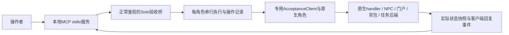

# MCP 游戏验收机器人：基础方案与螺旋推进

**状态：接口与流程设计，尚未实现、安装MCP或修改在线服务。** 用户确认本轮先建立基础方案，后续每轮实现一小组能力、用实际游戏结果验证，再决定下一轮；当前不把协议接通称为玩法验收完成。

## 目标与定位

让操作者通过MCP观察当前游戏，主动操作专用验收角色，触发正常游戏脚本，并调用可重复的验收流程。验收角色由操作者控制；公会核心队员和自动PQ bot是它的交互对象，也可在多角色场景中作为协作队员。它们共享正常游戏动作能力，身份、调度归属和验收职责分开。

这里的角色是**服务器端玩家替身**：用于验证服务器业务链、机器人行为、NPC/门户/物品/组队与副本结果。真实客户端的网络握手、封包加解密、渲染、输入和玩家操控体验仍有独立验收。

## 最小架构



- MCP进程负责工具协议、参数和结果呈现，不承担游戏状态的权威副本，也不直接连接MySQL。
- Solo验收桥沿当前管理端JWT和管理员权限鉴权，默认不开启，开启与角色配额维护在本地配置。全部新增代码维护在Solo，北斗submodule保持原样。
- 独立`AcceptanceClient extends Client`捕获`sendPacket`，在专用actor注册表中登记。不要继承`BotClient`或把验收玩家放入环境`BotRegistry`：聊天观察和入图脚本会按bot分支处理。
- 开放的能力由`game_capabilities`实际返回。接口契约可先设计齐，未实现或未验证的动作保持不可用；不创建空工具来宣称已支持。
- 先用进程内队列和有界事件缓冲即可，无需分布式消息总线、通用远程代码执行器或每角色一个LLM。

## 身份与生命周期

### 专用角色

角色由命名的验收profile选择，profile对应专用原生账号/角色及允许的世界、频道。`actor_open(profile_id)`不接收任意真人角色ID，不接管已有真人在线角色，也不提升普通角色GM权限。创建fixture时走原生创建规则，不克隆fmbot模板后改ID冒充原生角色。

选择持久验收profile，是为了后续能实际核对公会、任务进度和收益保存。第一轮若仅用临时内存聊天fixture，返回的capabilities必须标明不可用于副本登记、公会或持久化验收；它不算完成“原生验收角色”里程碑。

`Client.isLoggedIn()`与`Character.isLoggedInWorld()`不是同一个条件。原生`EIM.registerPlayer`检查后者。旧聊天探针刻意`loggedIn=false`以避免存档，因此其反射登记地图和临时身份仅可作经验参考，不能直接升级为长期通用角色。

### 独占操作与释放

- 同一个原生角色只能被一个有效控制session占用，打开前检查原生在线身份和自己的租约；重试`open`不重复登录或生成第二个角色。
- 每个actor串行分派游戏动作，调用原生handler前检查`validateState`及当前角色/场景；执行时设置`ThreadLocalUtil.currentClient`，在`finally`清除，保留原生锁与检查。
- 多角色可以并行，分别有队列。服务器停止/重启后session代次全部失效；重新打开时不复用旧世界、地图、EIM或OID。
- 释放角色先取消/排空本actor操作，再沿原生对话、队伍、事件注销、存档与离线流程清理；不复用明确跳过EIM/MatchChecker的环境bot离队捷径。默认保留持久fixture数据，清理只针对本次控制会话和本次创建的隔离资源。
- profile、客户端、地图及原生登记需要完整初始化与失败回滚；没有Netty socket时的Client会话依赖必须逐项测试，不以强改loggedIn或反射地图集合跳过正常生命周期。

## 工具接口草案

以下是后续实现契约，不是当前已经可调用的MCP工具。工具数量保持小，动作按实际能力增量开放。

| 工具 | 主要输入 | 实际结果／用途 |
|---|---|---|
| `game_capabilities` | 无 | 桥/协议版本、实际运行源码身份、后端在线状态、已实现并可用的动作与recipe版本、配额 |
| `game_observe` | 可选session或scene_ref、scope、since_cursor、limit | 角色/当前真实场景、队伍/任务/背包及有界事件增量；角色外全局观察按正常管理员范围 |
| `actor_open` | profile_id、world、channel、request_id | 原生角色控制session、actor_id、session_generation、初始快照；冲突明确失败 |
| `actor_close` | session_id、expected_generation、request_id | 可追踪的释放结果，确认任务停止与原生登记清理，保留存档 |
| `game_act` | session_id、request_id、expected_context、action | 执行单个已开放动作，快速返回operation_id及排队/执行状态 |
| `recipe_list` | 可选name | 内置流程的名称、版本、输入schema、步骤概要、需要能力和可用状态 |
| `recipe_run` | session_ids、name、version、inputs、request_id | 启动命名流程，返回run/operation_id；不长期阻塞MCP调用 |
| `operation_get` | operation_id、since_cursor、limit | 状态、当前步骤、实际事件、断言结果、失败原因、最后快照和证据ID |
| `operation_cancel` | operation_id、request_id | 发出取消并返回可追踪结果；只有游戏执行者确认停止/收尾后才标已取消 |

### 动作逐轮开放

- `chat`：普通聊天；明确普通对话与玩家命令的区别，不能把管理员命令当普通聊天探针。
- `npc_talk(npc_oid)`、`npc_answer(dialogue_version, choice)`：以当前地图的NPC运行OID交互，捕获正文/菜单/消息类型；选项必须属于当前对话版本，过期菜单不盲选。
- `move_to(x,y)`、`portal_enter(portal_name)`：发出移动后观察实际抵达；门户沿真实脚本和条件检查，不能用直接warp冒充正常跨图。导航可复用现有能力，但需要剔除仅用于表演的位移/技能捷径。
- `party_create/invite/accept/leave`：保留队长、容量、等级、邀请及实例流程；新profile不能自动改变真实玩家队伍。
- `pickup/drop/use_item/hit_reactor/attack`：按每项正常原生链逐个开放，真实归属、背包变化、道具消耗、技能条件与目标结果可观察；外观动作不算通过。

动作类型应有各自输入schema和范围校验。公共请求不接受任意Java方法、反射字段、SQL、JS文本或服务器脚本路径；“调用游戏脚本”通过NPC/门户等正常入口发生。需要测试数据准备时另列fixture准备步骤和前后快照，不纳入正常游玩通过证据。

NPC的`start()`本身可能传送、修改任务或发放物品，尚未选择菜单也可能有副作用。普通`npc_talk`按可变更游戏状态的动作记录；取消对话不意味着回滚已发生变化。用于“只看菜单”的预置检查流程只能选择已核对启动行为的具体NPC/场景，绑定被核对的脚本版本，并核对实际前后状态。

### 场景与回复

场景返回`worldId/channelId/mapId/mapInstanceKey/runtimeKey`及实际角色位置；NPC、怪物、门户、机关和地面物品使用运行OID/身份而非模板ID。EIM任务用真实实例对象的本次运行标识，Java挑战/比赛使用其后端身份。

没有actor session时，先读取world/channel及已加载场景摘要，再使用返回的`scene_ref`查看具体场景。不能仅凭mapId访问另一个队伍的私有实例，也不为一次只读查询自动创建任务实例。

角色快照区分等级/经验、HP/MP、队伍、公会、任务进度和背包；事件返回`seq/cursor/time/actor/session_generation/source/kind/payload`。正文与菜单结构化，必要时保留有界原始包摘要供协议核对，不输出账号密码/JWT。观察缓冲溢出要返回`cursor_expired`及新快照，不能悄悄漏事件仍宣称观察完整。

观察事实分为`player_visible`（NPC、场景、收到的消息）、`server_diagnostic`（EIM/调度内部状态）和`fixture_setup`（测试准备）。解谜规则验收默认用正常可见信息；诊断可定位问题，但不能读出隐藏答案后宣称机器人已完成反馈求解。

## 操作、超时与证据

MCP成功响应只证明工具调用结束。后台操作状态采用`QUEUED/RUNNING/WAITING/SUCCEEDED/FAILED/CANCEL_REQUESTED/CANCELLED/INDETERMINATE`；每项返回明确的`observed_outcome`、证据游标和当前上下文。`SUCCEEDED`需满足本操作声明的原生结果条件；复合流程还需全部必需断言通过。

```json
{
  "operation_id": "op-...",
  "status": "WAITING",
  "actor_id": 123,
  "session_generation": 7,
  "context": {"world_id": 0, "channel_id": 1, "map_id": 100000000, "map_instance_key": "..."},
  "step": "等待目标SocialBot回复",
  "evidence_cursor": 42,
  "observed_outcome": null,
  "assertions": []
}
```

- 普通动作的`request_id`按控制session去重，同ID不同参数拒绝；MCP断线重试不重复投物、交任务或领取奖励。尚无session的`actor_open`按鉴权主体＋profile＋request_id归并，重复请求返回同一次打开操作；该session已关闭时返回其实际状态，不自动新开。
- `expected_context`检查session代次、当前场景及必要时对话版本/目标OID。移动完成不以“指令入队”作证，交付完成要有实际背包、任务或脚本结果。
- 执行指令已发出但结果未知时保持`INDETERMINATE`，核对实际状态后再决定，不盲目重放副作用。断言失败/超时保存条件、最后快照和事件，不直接补发道具或修改clear标志。
- MCP的请求取消与游戏后台任务取消分开。关闭stdio客户端、工具超时或收到`notifications/cancelled`都不自动代表游戏动作停止，后台需有独立取消、活动代次和正常收尾。
- `operation_get`是可重连的稳定查询，不依赖客户端是否显示进度通知。长流程返回ID后轮询；输出截断/脱敏明确记录，证据以具备权限的本地artifact保存。

## 内置流程减少操作步骤

两类“脚本”分别处理：游戏原生NPC/门户/事件脚本沿正常入口执行；内置验收recipe只组合已开放动作、条件等待和断言。recipe采用版本化的简单步骤表，复杂场景使用小型专用执行器，先不构造通用脚本语言。

| recipe草案 | 输入和流程 | 通过证据 | 开放前提 |
|---|---|---|---|
| `observe_scene` | 无actor时按已返回scene_ref观察，或R2后使用已有session→快照→读取增量 | 位置、对象、游标一致；不自动打开角色或改变状态 | 单步观察在R1可用；命名recipe到R4开放 |
| `social_greeting` | 指定附近SocialBot→走近→准确名字点名→等待该对象回复 | 原生聊天handler、目标回复身份和收到的CHATTEXT；清理互动 | R2角色/聊天，移动需R3 |
| `npc_inspect` | 选择已核对启动无副作用的具体NPC/场景→获取正文/菜单→取消对话 | NPC_TALK结构、对话版本和真实前后状态；一般NPC不承诺无副作用 | R2原生交互与脚本核对；命名recipe到R4开放 |
| `portal_roundtrip` | 正常走到门户→通过→按规则返回 | 原生门户结果、真实地图实例、抵达；失败不传送绕过 | R3 |
| `party_lifecycle` | 多个专用profile创建/邀请/接受→核对名册→正常离队 | 邀请与原生名册一致，退出后无EIM/MatchChecker残留 | R3与多actor能力 |
| `pq_stage_probe` | 选择已实现规则和实际阶段→保留真人职责→执行分工→验证原生结果 | 当前实例分工、真实物品/机关/阶段和取消恢复；不凭本地DONE清关 | R5及对应PQ规则已实现 |

recipe清单要显示`planned/available/blocked`、版本、所需能力和参数。脚本批量操作的每一步仍记录operation和证据；不能因为一键化而跳过原生资格。后续可增加“暂停在某阶段”“单步继续”“等待真人操作”等调试流程。

## 螺旋迭代计划

每轮按同一循环：**界定本轮能力与可观察结果→实现最小切片→协议/单测→隔离服务验证→已授权部署冒烟→记录证据与限制→决定下一轮**。基础方案与每轮Issue保持分开；失败时在本轮修复并重验，不继续叠功能隐藏问题。独立实验使用临时库或一致副本；部署冒烟沿现有授权使用真实库并保留备份。

| 轮次 | 能力切片 | 本轮结束必须有的证据 |
|---|---|---|
| R1 协议与观察 | 本地stdio MCP、正常鉴权桥、capabilities与只读快照 | 初始化/协商、tools/list和call、真实后端身份/场景；未鉴权拒绝、结果无密钥；当前Codex实际可调用独立核对 |
| R2 专用角色与回复 | 原生持久fixture、session/操作队列、普通聊天、NPC正文/菜单捕获与取消 | 同一角色打开/释放/再加载，原生在线/存档连续；准确点名聊天往返、NPC菜单版本和过期选择拒绝；不混环境bot |
| R3 原生动作 | 移动、门户、组队和物品/机关逐项增量 | 每动作正常原生路径及结果；不可达/拒绝/失败清楚返回；真实库存与任务进度一致；多actor无互相控制 |
| R4 预置流程 | recipe发现/版本、run/status/cancel、条件等待、断言与证据 | 一键跑完整基础流程；中断/断线/重试/取消不重复收益；失败可定位到具体步骤与最后事实 |
| R5 组队协作验收 | 多actor分工、真人保留角色、单个PQ阶段和逐步扩展 | 一真人与合法bot编制逐阶段验证；双队/双频道隔离、同时站位、掉线补位与失败恢复；每种PQ独立留证 |

R5依赖[组队任务计划#13](https://github.com/Diluka/SoloMapling/issues/13)及[团队协作内核#14](https://github.com/Diluka/SoloMapling/issues/14)，不因MCP可发包或配置了recipe就宣称所有任务能通关。R2/R3可在R4流程成熟前单步验收，避免为了减少点击先做一个未经验证的大流程。

## MCP SDK与Codex接入

本轮只核对设计，不安装依赖或改本地Codex配置。2026-10-27实际查阅的官方Python SDK稳定版本为`mcp==2.3.0`，v2使用`MCPServer`；旧`mcp.server.fastmcp.FastMCP`属于v1维护线，若选用必须约束版本`<2`。新实现建议Python3.11以上、固定已验证的v2版本；实施时重新核对当时文档并提交依赖锁定。

stdio只用于本机MCP进程，游戏桥继续正常管理员鉴权；凭据放本地受限文件，MCP参数只传文件路径，不提交到仓库或写入工具输出。示例仅表示结构，路径与包名待实现确定：

```toml
[mcp_servers.solo_acceptance]
command = "/absolute/venv/bin/python"
args = ["-m", "solo_acceptance_mcp", "--config", "/absolute/local/acceptance-mcp.json"]
cwd = "/absolute/SoloMapling/tools/acceptance-mcp"
startup_timeout_sec = 15
tool_timeout_sec = 30
enabled = true
```

可信项目的`.codex/config.toml`可维护此配置，未信任项目不会加载项目层。分别验收“配置解析”“SDK stdio客户端能初始化/列工具/调用”“当前Codex工具目录已出现并能真正调用”。官方文档不保证当前聊天热加载，后续实施按实际重连情况报告，不能把写入配置当成当前会话已经可用。

R1可用官方SDK客户端直接启动stdio服务、列工具并调用只读快照，全程不调用模型。长任务应用层返回operation_id，协议progress只是补充；传输取消不能代替游戏取消。

## 当前源码依据

- [BotClient](../../beidou-integration/src/main/java/org/gms/client/BotClient.java#L38)、[BotRegistry](../../beidou-integration/src/main/java/soloMapling/beidou/BotRegistry.java#L57)、[GameplayHooks](../../beidou-integration/src/main/aspect/soloMapling/beidou/GameplayHooks.aj#L39)：环境bot身份、聊天排除与地图脚本分支。
- [CharacterFactory](../../upstream/BeiDou-Server/gms-server/src/main/java/org/gms/client/creator/CharacterFactory.java#L42)、[Character](../../upstream/BeiDou-Server/gms-server/src/main/java/org/gms/client/Character.java#L613)、[EIM](../../upstream/BeiDou-Server/gms-server/src/main/java/org/gms/scripting/event/EventInstanceManager.java#L270)：原生创建、角色在线状态、事件登记。
- [GeneralChatHandler](../../upstream/BeiDou-Server/gms-server/src/main/java/org/gms/net/server/channel/handlers/GeneralChatHandler.java#L39)、[NPCTalkHandler](../../upstream/BeiDou-Server/gms-server/src/main/java/org/gms/net/server/channel/handlers/NPCTalkHandler.java#L44)、[NPCMoreTalkHandler](../../upstream/BeiDou-Server/gms-server/src/main/java/org/gms/net/server/channel/handlers/NPCMoreTalkHandler.java#L35)、[ChangeMapHandler](../../upstream/BeiDou-Server/gms-server/src/main/java/org/gms/net/server/channel/handlers/ChangeMapHandler.java#L54)、[PartyOperationHandler](../../upstream/BeiDou-Server/gms-server/src/main/java/org/gms/net/server/channel/handlers/PartyOperationHandler.java#L41)：正常动作入口。
- [Client上下文](../../upstream/BeiDou-Server/gms-server/src/main/java/org/gms/client/Client.java#L220)、[NPC对话输出](../../upstream/BeiDou-Server/gms-server/src/main/java/org/gms/util/PacketCreator.java#L3333)、[原生拾取](../../upstream/BeiDou-Server/gms-server/src/main/java/org/gms/client/Character.java#L2003)、[环境离队捷径](../../src/main/java/soloMapling/ArtificialPlayer/BotPartySystem/BotPartyCommands.java#L29)：执行上下文与验收动作边界。
- [2101010的启动传送](../../upstream/BeiDou-Server/gms-server/scripts-zh-CN/npc/2101010.js#L22)、[1013002的启动任务完成与传送](../../upstream/BeiDou-Server/gms-server/scripts-zh-CN/npc/1013002.js#L1)：说明NPC对话开始就可能产生业务变化。

源码基线：Solo `58e0306d5863c591dd9f0a97f3d61f2c6e0de120`、官方北斗1.12 `75a86268738ca8845e06ea9d59ec36d15b22c91b`。旧聊天探针只作为已验证路径经验，本设计不会把临时内存fixture当成持久通用验收角色。

## 实际查阅的官方文档

- [OpenAI：Codex MCP配置](https://developers.openai.com/codex/mcp.md)、[项目配置与信任层级](https://developers.openai.com/codex/config-basic.md)。
- [MCP Python SDK主线说明](https://github.com/modelcontextprotocol/python-sdk/blob/main/README.md)、[v1维护线说明](https://github.com/modelcontextprotocol/python-sdk/blob/v1.x/README.md)。
- [固定v2.3.0服务端API](https://github.com/modelcontextprotocol/python-sdk/blob/v2.3.0/src/mcp/server/mcpserver/server.py)、[固定v2.3.0客户端API](https://github.com/modelcontextprotocol/python-sdk/blob/v2.3.0/src/mcp/client/client.py)、[PyPI2.3.0版本元数据](https://pypi.org/pypi/mcp/2.3.0/json)。版本结论来自SDK/PyPI，不归为OpenAI产品版本。
- [MCP请求取消规范](https://modelcontextprotocol.io/specification/latest/basic/utilities/cancellation.md)。

## 基础方案与实施跟踪

- [基础方案](https://github.com/Diluka/SoloMapling/issues/55)
- [R1：MCP协议接通与真实游戏只读观察](https://github.com/Diluka/SoloMapling/issues/56)
- [R2：独立持久验收角色、聊天与NPC回复](https://github.com/Diluka/SoloMapling/issues/57)
- [R3：原生移动、门户、组队与物品动作逐项验证](https://github.com/Diluka/SoloMapling/issues/58)
- [R4：内置验收流程、可中断运行与证据报告](https://github.com/Diluka/SoloMapling/issues/59)
- [R5：多验收角色与单任务阶段的团队协作验证](https://github.com/Diluka/SoloMapling/issues/60)
- [Milestone](https://github.com/Diluka/SoloMapling/milestone/3)

各实施Issue保持待办；每轮完成后补充实际证据再关闭，不因本设计交付而关闭实施任务。
