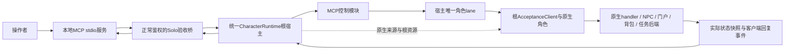

# MCP 游戏验收机器人：基础方案与螺旋推进

**状态：观察、原生角色、包事件、普通聊天和 #75 中心首屏/取消已完成隔离及实际部署验收；#110 无收益 NPC 回复也已完成隔离及实际部署验收。** #117 共享上下文已完成完整构建、CI、隔离及实际部署验收并关闭。该轮已验收交付源码为 `8f8ebf485c719b868d5ba7ab4a6950632bfff730`（[PR #130](https://github.com/Diluka/SoloMapling/pull/130)）；#63、#67～#70、#72、限频验收修正 #74、#75 和 #110 已关闭。已部署七工具，`game_act` 支持 `chat/npc_center_open/npc_cancel/npc_reply`，回复仅开放 select/decline。实际开放项始终以 `game_capabilities.enabled_tools/actions` 为准，`implementation_round` 仍为 `R2a`。#110 仅开放已审查的有限菜单选择/拒绝；礼包接受、完整城镇菜单、付费出行、SocialBot 回复、移动和 recipe 仍待后续，宿主原生工具加载与真实客户端玩法分别记录。每个切片完成实际验收后及时关闭对应 Issue，并同步文档与相关 `AGENTS.md`。

安装、连接配置、测试及实际 stdio 冒烟命令见 [工具运行说明](../../tools/acceptance-mcp/README.md)。协议接通、服务器业务结果与真实客户端玩法分别记录。

## 开启观察与原生角色

源码默认关闭验收桥及角色控制。只观察时在本地 `application.yml` 的现有 `solomapling` 节点添加 `acceptance.enabled: true`；R2a 还需显式开启 `actors-enabled` 并配置专用 profile。合并到现有配置，不替换数据库、JWT、语言或人口定制，修改后重启应用：

```yaml
solomapling:
  acceptance:
    enabled: true
    actors-enabled: true
    actor-profiles:
      primary:
        account-name: mcp_primary
        account-password: "replace-with-a-local-secret"
        character-name: McpPrimary
        world: 0
        channel: 1
        allow-create: true
```

此处密码只是占位，真实值仅留在本地受限配置中。profile ID 使用 1～48 个字母、数字、下划线或连字符；账号名必须以 `mcp_` 开头，总长 5～13 个字符，且不同 profile 不能复用同一账号。请求中的可选 world/channel 必须与 profile 一致，不能借参数选择其他世界、频道或任意玩家角色。

`allow-create` 默认 `false`；开启后允许通过北斗原生服务创建缺少的专用账号、角色，并完成首次登录条款初始化，不提升 GM/webadmin。已有账号须为未封禁的普通账号、目标角色须为 GM 0；账号已在线或被其他客户端占用时拒绝接管。新角色沿原生新手创建和出生规则进入游戏，R2a 不提供调级或传送。

关闭 `actors-enabled` 时，后端只开放 R1 两项观察工具；客户端可列出七工具，不代表后端角色接口或任何动作已经开启。

## 与二代、PQ 共享基础

[共享入口 #116](https://github.com/Diluka/SoloMapling/issues/116) 统一跟踪一份中立Java后端，接口及作用域见 [共享游戏基建说明](../shared-game-foundation/README.md)。[#117 中立上下文](https://github.com/Diluka/SoloMapling/issues/117) 已加入 WorldEpoch、角色/场景结构检查和 MCP/Bot 两种薄适配，已完成完整构建、CI、隔离和实际部署验收；第二类Bot合同测试与实际MCP证据分开。当前实际运行已包含此共享实现，七工具和四种动作的公开契约不因本轮提炼增加。

共享上下文只核对已指定的原生对象关系，不读普通登录标志，不依赖验收开关、`Server.getInstance()`、全世界目录或包捕获。MCP继续保留JWT/admin、owner/profile、账号lease/在线Client、GM0、排除bot、普通登录状态和request_id历史。Bot薄适配以BotClient及精确BotRegistry登记授信，保持V1角色真实loggedIn=false；其真实原生对象/宿主路由替身测试不代表完整V2模块已经运行。V2/PQ通过内部Java适配消费，不经Python/HTTP/MCP发动作，也不复制整个ActorControlService。

世界token、MCP session、V2 runtime/模块代次、包sequence和dialogue_version分别归各自层；内部CharacterRef能跨正常地图变化继续有效，SceneRef绑定具体Map/EIM。共同生命周期先停世界 token，新动作拒绝旧绑定。[#118](https://github.com/Diluka/SoloMapling/issues/118) 以公共 scope/lane 接入现有 MCP 顺序，并用准确停止票据及精确资源 `DrainPermit` 收尾原生角色，不增加 ignoreEpoch 入口。取消请求、实际 body/队列结算、资源释放及卸载完成分别记录；MCP 仍在实际 work 结算后归还 ACTION 额度。详见[执行与排空参考](../shared-game-foundation/execution-scope.md)，交付状态和完整构建、CI、隔离及实际部署证据以对应 Issue 为准，代码合并或单项测试不代替部署验收。

本轮角色场景观察改为定点登记，world/scene目录浏览保留原发现路径。原生读取故障仍是503而非LOST，场景/context不符409与已知旧session410分开；[#114](https://github.com/Diluka/SoloMapling/issues/114) 的Python映射最小修单独验收，不从共享测试推导已修复。

[#118作用域/排空](https://github.com/Diluka/SoloMapling/issues/118) 和 [#119原生动作/证据](https://github.com/Diluka/SoloMapling/issues/119) 的实现与各层验收分别记录。

#119 将普通聊天接入一份公共 Java 执行链；MCP 外层保留 request_id/操作历史、原有错误与 JSON 语义，真正 handler 派发检查点与操作开始执行分别记录。聊天只向同一宿主的 lane 提交一次，结果事实与 work 真实结算分开，七工具四动作不增加。证据 source/completeness 和 Bot 无收包的未知语义见[共享动作参考](../shared-game-foundation/native-actions.md)。

后续 [#120按需事实/事件](https://github.com/Diluka/SoloMapling/issues/120)、[#121原生NPC会话](https://github.com/Diluka/SoloMapling/issues/121) 及 #122～#129 各动作保持待实现，逐叶范围见共享说明。MCP #110 已验收不等于公共 #121 交付，#119 普通聊天也不包含 NPC 来源/版本/路由；现有NPC来源/路径/offer策略的提炼债务仍留#121。#112礼包、#113出行暂后排，任务树和里程碑保留，公共切片、MCP玩法、V2组合与PQ通关分别留证。

## 统一宿主内的 MCP 控制模块

[#139 首环](https://github.com/Diluka/SoloMapling/issues/139) 将现有 actor 接入同一个 `CharacterRuntime`：根宿主持有原生角色资源与唯一 lane，MCP 控制模块消费宿主动作/观察上下文，外层保留 JWT/profile/owner/request_id、历史和额度。具体接入及回归/部署约定见 [MCP 模块说明](runtime-module.md)，交付状态和各层证据以对应 Issue 为准，不把代码存在或合并当实际部署。

`runtime_generation` 仍是 WorldEpoch 的世界代次，不改为宿主或模块 ID。模块暂停/卸载默认停止输入并排空命令，保留根 Client 的既有 CM；显式 `npc_cancel` 或 root `actor_close` 沿正常规则处理。完整暂停/卸载重挂及复杂关闭由 [#140](https://github.com/Diluka/SoloMapling/issues/140) 分别验收，本轮不公告生产自治、巡逻或刷怪能力。

## 目标与定位

让操作者通过MCP观察当前游戏，主动操作专用验收角色，触发正常游戏脚本，并调用可重复的验收流程。验收角色由操作者控制；公会核心队员和自动PQ bot是它的交互对象，也可在多角色场景中作为协作队员。它们共享正常游戏动作能力，身份、调度归属和验收职责分开。

这里的角色是**服务器端玩家替身**：用于验证服务器业务链、机器人行为、NPC/门户/物品/组队与副本结果。真实客户端的网络握手、封包加解密、渲染、输入和玩家操控体验仍有独立验收。

## 最小架构



- MCP进程负责工具协议、参数和结果呈现，不承担游戏状态的权威副本，也不直接连接MySQL。
- Solo验收桥沿当前管理端JWT和管理员权限鉴权，默认不开启，开关与 profile 维护在本地配置。当前角色并发上限固定为4，实际额度由 capabilities 返回。全部新增代码维护在Solo，北斗submodule保持原样。
- 独立`AcceptanceClient extends Client`捕获`sendPacket`，在专用actor注册表中登记。不要继承`BotClient`或把验收玩家放入环境`BotRegistry`：聊天观察和入图脚本会按bot分支处理。
- 开放的能力由`game_capabilities`实际返回。接口契约可先设计齐，未实现或未验证的动作保持不可用；不创建空工具来宣称已支持。
- 命令使用同一宿主的既有有界 lane，角色观察来自根来源；外部 operation 是请求与结果历史。Session 或模块不再各建队列/物理工作账本，也不引入分布式消息总线、任意代码执行器或每角色一个 LLM。

## 身份与生命周期

### 专用角色

角色由命名的验收profile选择，profile对应专用原生账号/角色及允许的世界、频道。`actor_open(profile_id)`不接收任意真人角色ID，不接管已有真人在线角色，也不提升普通角色GM权限。创建fixture时走原生创建规则，不克隆fmbot模板后改ID冒充原生角色。

R2a 使用原生持久角色，后续可在此基础上核对公会、任务和收益保存。角色的创建、账号登录、选角、进入频道与正常退出复用北斗原生服务、Client 和 handler；LOGIN 与 CHANNEL 使用独立的 `AcceptanceClient`。单测和接口可用不等于原生业务链已完成实际验收。

`Client.isLoggedIn()`与`Character.isLoggedInWorld()`不是同一个条件。原生`EIM.registerPlayer`检查后者。旧聊天探针刻意`loggedIn=false`以避免存档，因此其反射登记地图和临时身份仅可作经验参考，不能直接升级为长期通用角色。

### 独占操作与释放

- 同一个原生账号/profile 只能被一个有效控制 session 占用。Solo 的账号所有权守卫覆盖登录状态查询、在线登记及迟到清理，防止并发客户端互相接管；不踢掉原先在线的真人。同一个打开请求重试不重复登录或生成第二个角色。
- R2a 每个 profile 串行执行生命周期操作，最多同时占用 4 个 session；不同鉴权主体不能查询、取消或关闭彼此的操作。已开放的原生 handler 调用保留 `validateState` 和原生上下文；后续游戏动作也必须经过串行队列与相应状态检查。
- 多角色可以并行，各自由宿主管理唯一 lane。服务器停止/重启后session代次全部失效；重新打开时不复用旧世界、地图、EIM或OID。
- 释放角色先取消/排空本actor操作，再沿原生对话、队伍、事件注销、存档与离线流程清理；不复用明确跳过EIM/MatchChecker的环境bot离队捷径。默认保留持久fixture数据，清理只针对本次控制会话和本次创建的隔离资源。
- profile、客户端、地图及原生登记需要完整初始化与失败回滚；没有Netty socket时的Client会话依赖必须逐项测试，不以强改loggedIn或反射地图集合跳过正常生命周期。

## 工具接口与后续草案

下表区分已部署能力和后续设计。已部署七工具包括 `game_act` 的四种动作，npc_reply仅支持已审查的select/decline。角色/动作接口须开启双开关，其他 NPC、移动和 recipe 不注册空能力。

| 工具 | 主要输入 | 实际结果／用途 | 当前范围 |
|---|---|---|---|
| `game_capabilities` | 无 | 版本、运行源码身份、后端在线状态、实际工具与容量 | R1 |
| `game_observe` | scope=world/scene/actor、scene_ref、limit；actor 另需 session_id/expected_generation，可带 since_cursor | 已加载场景或专用角色的只读快照与包窗口，不创建地图或角色 | world/scene 为 R1；actor 为 #70 包事件观察 |
| `actor_open` | profile_id、可选 world/channel、request_id | 排队原生登录，返回 operation_id 与 session/session_generation | R2a |
| `actor_close` | session_id、expected_generation、request_id | 排队正常离线，查询清理及持久化核验结果，保留 fixture | R2a |
| `operation_get` | operation_id、since_cursor、limit | 操作终态、实时 session、原生角色快照及有界生命周期事件 | R2a |
| `operation_cancel` | operation_id、request_id | 请求取消；继续查询实际终态与清理结果 | R2a |
| `game_act` | session_id、expected_generation、request_id、action、parameters、expected_context | 同 session 排队，返回 ACTION 与实际原生结果 | chat/中心首屏/取消/npc_reply已部署，reply仅select/decline |
| `recipe_list` | 可选 name | 命名流程、版本、输入 schema、步骤与需要能力 | R4，未注册 |
| `recipe_run` | session_ids、name、version、inputs、request_id | 启动命名流程，返回可追踪 run/operation_id | R4，未注册 |

R2a 的 HTTP 路由、信封与逐项调用例子见 [工具契约](../../tools/acceptance-mcp/README.md#原生鉴权与操作契约)。#70 沿用 `game_observe` 扩展 actor 只读观察，不新增第七个工具；具体契约见下文。

### 后续动作逐轮开放

- `npc_talk(npc_oid)`、`npc_answer(dialogue_version, choice)`：以当前地图的NPC运行OID交互，捕获正文/菜单/消息类型；选项必须属于当前对话版本，过期菜单不盲选。
- `move_to(x,y)`、`portal_enter(portal_name)`：发出移动后观察实际抵达；门户沿真实脚本和条件检查，不能用直接warp冒充正常跨图。导航可复用现有能力，但需要剔除仅用于表演的位移/技能捷径。
- `party_create/invite/accept/leave`：保留队长、容量、等级、邀请及实例流程；新profile不能自动改变真实玩家队伍。
- `pickup/drop/use_item/hit_reactor/attack`：按每项正常原生链逐个开放，真实归属、背包变化、道具消耗、技能条件与目标结果可观察；外观动作不算通过。

动作类型应有各自输入schema和范围校验。公共请求不接受任意Java方法、反射字段、SQL、JS文本或服务器脚本路径；“调用游戏脚本”通过NPC/门户等正常入口发生。需要测试数据准备时另列fixture准备步骤和前后快照，不纳入正常游玩通过证据。

NPC的`start()`本身可能传送、修改任务或发放物品，尚未选择菜单也可能有副作用。普通`npc_talk`按可变更游戏状态的动作记录；取消对话不意味着回滚已发生变化。用于“只看菜单”的预置检查流程只能选择已核对启动行为的具体NPC/场景，绑定被核对的脚本版本，并核对实际前后状态。

### 场景与回复

场景返回`worldId/channelId/mapId/mapInstanceKey/runtimeKey`及实际角色位置；地图中的NPC、怪物、门户、机关和地面物品使用运行OID/身份而非模板ID。#75 的固定中心是原生远程 UI 入口，不要求地图出现该 NPC，也不接受任意模板ID；后续地图 NPC 仍需同场景/OID/距离校验。EIM任务用真实实例对象的本次运行标识，Java挑战/比赛使用其后端身份。

没有actor session时，先读取world/channel及已加载场景摘要，再使用返回的`scene_ref`查看具体场景。不能仅凭mapId访问另一个队伍的私有实例，也不为一次只读查询自动创建任务实例。

R1 的 `game_observe` 仅接受 `scope=world|scene`、`scene_ref` 和整数 `limit`（默认100，1～500）。world 返回 `worlds` 与 `scenes.items`；scene 返回 `context` 及六类 `{total_count,truncated,items}` 对象。快照明确为 `server_diagnostic`、`best_effort`，附 `runtime_generation`；不支持事件流。场景目录来自已加载频道地图及在线成员引用的实例，未被在线成员引用的私人实例不作全局枚举。当前目录没有分页或筛选，超过 `limit` 会标记截断，最大只能取得前500个场景引用；分页/筛选仍待实现，不能把有限目录称为全量可访问。R2a 的 `operation_get` 可在 `session.actor.scene` 直接返回角色当前真实场景身份及 `scene_ref`，不受前500目录限制；再用该引用做场景观察，无需猜测 map_id。

同一 `map_id` 的不同实际地图对象得到不同引用，场景卸载、停服或世界重启后旧引用失效。参数错误返回HTTP400，失效引用410，读取中世界代次变化409，离线/停止503。桥默认关闭时沿原生未映射路径处理，可能是HTTP200加业务失败码40001，不能仅凭HTTP200判断桥可用；SDK也检查原生 `code=20000` 与实际结构。

R2a 原生角色快照包含身份、等级/经验、HP/MP、金币、职业、队伍、公会与登录登记，以及背包和任务摘要。#75 另在 actor 快照增加只读 `tickets_summary={nx_credit,maple_point,nx_prepaid}`，分别读取原生 cash 类型1/2/4，并增加当前 `dialogue` 状态；这些观察字段不提供改余额或发券能力。背包按类别最多100项，仅含物品ID、位置、数量；任务最多100项，仅含任务ID和状态，不包含任务计数与所有装备属性。两类摘要均标明总数及截断。

`operation_get.events` 始终是生命周期记录，每个 operation 最多保存64条，游标基于其中的 `seq`。R2a 的 `session.actor.packet_events` 是最多256条 `sequence/opcode/length` 包摘要；#70 从同一包缓冲投影该兼容视图，同时提供独立的结构化包观察窗口，不重复保存一份正文历史。两种游标不能互用，也不能把旧包摘要当成已经收到预期回复的证明。

观察事实分为`player_visible`（NPC、场景、收到的消息）、`server_diagnostic`（EIM/调度内部状态）和`fixture_setup`（测试准备）。解谜规则验收默认用正常可见信息；诊断可定位问题，但不能读出隐藏答案后宣称机器人已完成反馈求解。

## #70：专用角色的只读包事件观察

此切片是 [R2b #64](https://github.com/Diluka/SoloMapling/issues/64) 的原生子 Issue，供后续 R2c 复用；已随 PR #71 完成隔离和实际部署 SDK 验收，#70 已关闭。它只读取角色已经收到的消息，不发送聊天、不开始 NPC 对话，也不执行游戏脚本。`game_capabilities.implementation_round` 保留 `R2a`，不能用轮次字段判断本扩展是否存在；须同时确认 `scopes` 包含 `actor`，且 `actor_control.packet_observation` 公告实际解码范围。角色开关关闭时不公告 actor scope。

```json
{
  "capacity": 256,
  "maximum_text_chars": 1024,
  "cursor_scope": "session_packet_sequence",
  "decoded_packets": [
    {"event_type": "chat_text", "opcode": 162},
    {"event_type": "player_hint", "opcode": 214},
    {"event_type": "server_message", "opcode": 68, "message_types": [0, 1, 2, 3, 4, 5, 6, 7]}
  ]
}
```

上例是 `actor_control.packet_observation` 的结构。#70 交付时保持六工具且 `actions=[]`；已部署 #72 单独增加 `game_act` 与 `actions=["chat"]`，#75 进一步增加两个中心动作与 NPC 解码类型。`recipes=[]`、`event_stream=false` 不变，包观察仍使用拉取窗口，不是订阅推送。

### 请求与身份

```text
game_observe(scope="actor", session_id="实际session_id",
             expected_generation=实际代次, since_cursor=0, limit=100)
```

actor 必须带 session ID 和1～Long.MAX_VALUE 的 `expected_generation`，不接受 `scene_ref`、账号密码或任意角色 ID。`since_cursor` 为0～Long.MAX_VALUE，`limit` 为1～500；三者均为严格整数，拒绝 bool、浮点和数值字符串。world/scene 保留现有参数与路由，拒绝 session 参数及非零包游标；scene 仍需真实 `scene_ref`。

actor 请求使用只读 `POST /solo/acceptance/v1/actor/observe`，沿正常 JWT/ROLE_ADMIN 和 owner 隔离，信封 data 为 `session_id/expected_generation/since_cursor/limit`。SDK 为信封生成的 `requestId` 不是写操作去重键；查询不创建 operation、不占历史或首次关闭名额，也不进入游戏动作队列。

返回包含 `schema_version/captured_at/scope/runtime_generation/session_id/session_generation/profile_id/actor/events`；#139 在 `actor.runtime` 投影只读宿主/模块诊断，字段与独立游标边界见 [MCP 模块说明](runtime-module.md#只读-runtime-诊断)，不能作为任意 runtime/CID 控制入口。顶层快照是 `server_diagnostic`、`best_effort`；已解码消息逐条标记 `information_level=player_visible`。`actor.scene` 是读取时的实际当前场景，不冒充每条历史消息发生的场景；观察不加载地图或创建实例。

仅有效 OPEN session 可观察。未鉴权或跨 owner 分别拒绝；未知 session 为404，错误代次、已关闭/取消/丢失/隔离或旧世界的已知 session 为410，OPENING/CLOSING 为409，世界停止为503，读取中状态或代次变化为409。进程重启后旧 ID 也可能成为404；不能通过操作历史查询绕过失效 session 读取正文。

### 独立包窗口

`events` 返回 `items/next_cursor/oldest_cursor/latest_cursor/cursor_expired/truncated/capacity/dropped_events_total/malformed_events_total`。每条包保留 `sequence/received_at/opcode/length`；已知包增加扁平的 `event_type/decode_status` 与对应字段。未知或畸形包同样占一个序号，只返回固定摘要和原因，不输出原始包、hex、异常正文或凭据。

- 包游标只在同一个 session 的频道 `AcceptanceClient` 中有效，新 session 可从1重新计数；与 `operation_get.since_cursor` 的生命周期游标独立。
- `since_cursor` 表示已消费到的序号，返回 `sequence > since_cursor` 的保留事件，严格升序，最多 `limit` 条。读取不删除事件，同一游标可重复读取同一前缀。
- `next_cursor` 是本页最后一条 sequence；空页保持输入游标，不能直接跳到 `latest_cursor`。`truncated=true` 表示保留窗口内还有本页未装下的事件。
- 每个客户端只保留256条包事件；最早历史已淘汰且 `since_cursor < oldest_cursor - 1` 时明确 `cursor_expired=true`，同时从当前最早保留项继续返回。它与分页截断独立，`limit>256` 也不扩大缓冲。
- 尚无包时 oldest/latest 均为0；未来游标 `since_cursor > latest_cursor` 返回 HTTP400、`packet_cursor_ahead`。窗口及计数在包锁内一次截取，角色/场景快照仍是 best effort，不能宣称两者为原子游戏快照。

### 解码范围与验收依据

| 消息 | 结构化字段与边界 |
|---|---|
| `CHATTEXT 0xA2` | `event_type=chat_text`，含 sender_character_id、gm、text、show |
| `PLAYER_HINT 0xD6` | `event_type=player_hint`，含 text、width、height、enabled；仅正文恰为 `.` 时 clears_previous=true |
| `SERVERMESSAGE 0x44` type0～7 | `event_type=server_message`，含 message_type、text；type3 另含 channel_id/mega_ear，type4 含 ticker_enabled，type6 含 trailing_value，type7 含 npc_template_id |
| NPC_TALK | 已部署 #75 解码 speaker_type=4/message_type=4，含 npc_template_id、speaker、text；#110增加type12，其他布局仍为摘要 |
| 其他消息 | `packet_summary`、`decode_status=unsupported` 与固定原因；包括未支持的 NPC_TALK 布局及 SERVERMESSAGE type |
| 畸形包或坏编码 | 有界 `packet_summary`、`decode_status=malformed` 与固定原因，递增 malformed 计数，不向原生 sendPacket 调用链抛解码异常 |

正文沿角色原生字符集解码，当前中文 profile 为 GBK；严格检查长度与编码。每条最多1024个 Unicode 字符（码点），超出标记 `text_truncated=true`。SERVERMESSAGE type4 的 ticker flag 在字符串之前，type6/7 的尾字段需完整；不把未知布局当通用文本。仅观察 type7 的 NPC 模板字段不代表已实现 NPC 对话。

本切片已通过正常 `actor_open` 收到真实 type4 频道公告，并完成隔离和实际部署 SDK 验收，没有注入包或新增发送动作。实际部署公告为 `Welcome to Scania!`，共观察31包；隔离及实际部署分别验证分页/重读、未来游标拒绝、关闭后拒绝及同 CID 新 session 重开，最终正常保存退出。在 #70 范围内，GBK 中文和 CHATTEXT/PLAYER_HINT 解码由原生组包测试验证，未执行真实聊天或提示往返；#72 的中文聊天隔离/实际部署结果见下文，机器人回复仍待后续。溢出/畸形等分支由确定性测试补足。#70 关闭不代表 #64/#65 的实际交互已完成；运行命令与恢复检查点见 [工具运行说明](../../tools/acceptance-mcp/README.md)。

## #72：普通聊天动作与自身原生回声

此切片属于 [R2b #64](https://github.com/Diluka/SoloMapling/issues/64)，基于已验收的原生角色与包观察，仅增加 `game_act` 的 `action=chat`。已随 PR #73 完成隔离与实际部署 SDK 中文聊天验收，#72 和其限频修正子项 #74 已关闭；SocialBot 回复尚未验收。验收角色可在出生地图10000测试自身广播，不要求出行；后续正常 NPC 出行及 SocialBot 对话仍分别验证。

### 调用与正常发言规则

```text
game_act(session_id="实际session_id", expected_generation=实际代次,
         request_id="由调用方保存的唯一请求ID", action="chat",
         parameters={"text": "聊天验收 nonce"},
         expected_context={"scene_ref": "实际场景引用",
                           "runtime_generation": "实际世界代次"})
```

该工具可改变游戏状态，标注为非只读、非破坏、幂等及开放世界操作。桥路由为 `POST /solo/acceptance/v1/actor/act`；仍沿正常管理端鉴权、owner 隔离及北斗 `{requestId,data}` 信封，调用方的 `request_id` 只进入外层 `requestId`。data 只允许 `session_id/expected_generation/action/parameters/expected_context`，parameters 只允许 text，expected_context 只允许 scene_ref/runtime_generation；不接受任意方法、脚本、角色ID或可控的聊天 show 字节。

`expected_context` 来自最近一次 actor 观察，不能以 map_id 代替。受理及实际出队时均检查 owner、session/代次、原生 handle、世界和场景；输入错误在排队前拒绝，排队期间变化另以操作失败或取消返回。`QUEUED` 与 HTTP 受理成功不等于已经发言。

- text 为非空、非全空白字符串，长度1～127个 UTF-16 code unit，以 Java `String.length()` 为准，不是127字节或127个 Unicode 码点。保留提交原文，不 trim 后发送。
- 首字符 `@` 属于玩家命令、`/` 不进行正常广播，本动作均拒绝；普通 GM0 角色的 `!` 文本沿原生规则处理，不提升权限。
- 使用角色原生字符集严格编码，当前中文 profile 为 GBK。不可编码字符（例如 emoji）和坏代理字符应拒绝，不静默替换为问号。
- 使用正常 `GeneralChatHandler.validateState` 和 handler、ThreadLocal client 上下文及原生封包，固定 show=0。保留原生200ms限频、禁言和广播规则，不重置计时、不自动 sleep/retry 绕过。未得到回声时也不自动重发。

### 排队、幂等与取消

ACTION 经 MCP 模块消费该角色宿主的唯一 lane，与根 OPEN/CLOSE 保持顺序，不在 HTTP 线程直接写游戏状态。执行队列容量固定8，每 session 最多7个尚未结束的 ACTION（包括运行中的操作），为首次 close 保留物理队列槽。尚未出队的取消任务仍占额度，实际结束后才归还；容量不足返回429。

新增 ACTION 同时遵守进程内256条操作/去重历史，并保留所有存活 session 的首次关闭名额。去重键为 ACTION＋owner＋session＋request_id；同键相同正文、动作、代次和完整 context 返回原操作，不再次广播，不同参数冲突。去重指纹保存正文 SHA256；operation、生命周期事件和终态历史不保存聊天正文，只保存固定原因、匹配布尔值和包序号等证据。正文只通过当前有效 session 的有界包窗口观察，关闭后拒绝策略不变。

- 未开始原生 dispatch 的 ACTION 可请求取消；只有实际出队确认未发言后才到 `CANCELLED`，结果为 `chat_cancelled_before_dispatch`、`native_dispatch_started=false`。取消聊天不关闭或释放 actor。
- close/stop 阻止新动作，并取消尚未 dispatch 的排队动作，再正常保存退出；这些短路任务不能把 CLOSING/QUARANTINED 会话恢复为 OPEN。
- 已开始的广播不能撤回。取消后继续核对真实结果；匹配回声时仍为成功，并用 `cancel_too_late` 表明取消过晚。已发生的广播不因之后关闭/停服而改写为已取消。

### 成功证据与验收范围

操作复用 `operation_get/cancel`，新增 `kind=ACTION`、`action=chat`。只有在本次 dispatch 前记录的包游标之后，实际接收到 `CHATTEXT 0xA2`，且自身 CID、完整原文、show=0 和 `text_truncated=false` 全部匹配，才可报告 `SUCCEEDED`、`step=native_chat_broadcast_observed`、`result.observed_outcome=native_chat_broadcast`。结果另含 `native_dispatch_started/echo_matched/sender_character_id/echo_sequence/packet_cursor_before/packet_cursor_after/cancel_too_late`，不含原文。

原生 handler 返回不代表成功；旧回声、其他角色的同文消息、0x44 系统公告均不能代替本次自身回声。完整窗口内无匹配回声为 `FAILED/native_chat_not_broadcast`；原生异常或必要事件已丢失且无法确认时为 `INDETERMINATE/native_chat_outcome_unknown`，保留原请求ID、不盲重放。已观测到的广播事实不能因后续日志/观察异常被改写为未发送。

#72 交付时的 capabilities 在顶层 `enabled_tools` 包含 game_act，`actions=["chat"]`；`actor_control.maximum_pending_actions_per_session=7`、`actor_executor_queue_capacity=8`。在线时另公告原生 `chat_minimum_interval_ms=200` 和实际 `native_clock_update_interval_ms`；后者来自北斗配置，不猜测默认值。原生限频使用缓存时钟，墙钟等待250ms不一定足够；验收脚本正常发送第二条前等待 `max(250, 最小间隔 + 时钟更新间隔)`，超过本轮操作超时则在登录前拒绝，失败不自动重发。该实物问题由 #72 子项 [#74](https://github.com/Diluka/SoloMapling/issues/74) 修正并验收关闭，原始失败证据保留。`implementation_round` 继续为 `R2a`，以明确工具与动作字段判断可用性。#75 已交付固定中心首屏与取消；#110 已交付有限NPC回复，其他NPC、移动、任意脚本和 recipe 尚未实现。

本项已在隔离及实际部署使用官方 MCP SDK 于出生地图发出两条带运行 nonce 的 GBK 中文普通聊天，每条均只收到一次真实自身广播。实际部署回声序号为32、33；第二条按200ms+777ms留出等待，实测在首操作完成后等待1014.38ms。已验证相同请求不重复广播、独立正文观察、终态历史无正文、正常保存退出及同 CID 重开，数据与网页证据分别留存。排队满额仍能 close、取消和原生未广播等边界由确定性测试补足；真实客户端画面未验。#72/#74 已关闭，#64 继续保留 SocialBot 回复、提示菜单、话题与告别等实际交互，NPC 出行前置由 #65 继续推进。命令与恢复检查点见 [工具运行说明](../../tools/acceptance-mcp/README.md)。

## #75：原生脚本中心首屏与正常取消

此切片属于 [R2c #65](https://github.com/Diluka/SoloMapling/issues/65)，复用七工具和既有 ACTION 队列，仅增加两种固定动作；实现、隔离与实际部署 SDK 首屏/取消验收均已通过：

```json
{"action":"npc_center_open","parameters":{}}
{"action":"npc_cancel","parameters":{"dialogue_version":123}}
```

其余 `game_act` 参数仍需当前 session/代次、调用方 request_id 与最近观察的 expected_context。`npc_center_open` 的 parameters 必须为空对象，`npc_cancel` 只接收1～Long.MAX_VALUE的严格整数 dialogue_version；123只是示例，应传实际最新版本。两动作同样受 owner、当前原生对象、世界/场景、幂等、队列容量和首次 close 预留约束，入队与出队均校验；不接收 NPC 模板、地图 OID、脚本名/路径、菜单选项或原始封包。

### 固定入口与首屏证据

`npc_center_open` 沿原生 `ENTER_MTS → EnterMTSHandler` 的 UI 入口，在派发时确认 `use_mts=false`，只打开固定脚本中心 NPC **9900001**；配置为true则拒绝，避免进入MTS保存/离场分支。打开前要求无现存 CM/QM，不能用原生 start 覆盖其他对话。它不是远程点击地图NPC，无须该模板出现在出生图10000，也不提供任意NPC调用。

本切片只读取已审查中心脚本的首屏 `sendSimple`，不选择菜单、领取礼包、转职、传送或推进任务。一般 NPC 的 start 仍可能有副作用；中心首屏的结论不能推广到其他脚本。实际验收需核对基础镜像正在运行的脚本及语言，不能只检查JAR中的源码。

打开成功必须在本次 dispatch 后实际收到 `NPC_TALK 0x130`：speaker_type=4、npc_template_id=9900001、message_type=4、speaker=0，并确认仍为同一活跃原生 CM、无QM、旧式 levelType=null，才返回 `center_dialogue_opened`。原生方法返回、包存在或HTTP受理均不足；脚本可能发包后立即结束，需另核当前CM。

在 #75 交付范围内，decoder 只新增此 type4 布局，沿原生字符集及既有256包/1024 Unicode码点上限，核对包尾；不猜测其他NPC消息布局，也不新增完整选项解析。未知或畸形NPC包仍是固定摘要，不打断原生发包。

### 对话版本、取消与清理

`actor.dialogue` 返回 `dialogue_version/packet_sequence/entry_type/npc_template_id/message_type/supported/active`。版本直接使用该session最新NPC包的 sequence；与 session_id/代次一起解释，不能当 operation 游标。只有当前CM仍为捕获时的同一对象且无QM，才可 `active=true`；原生对象不对外序列化。每个新NPC包都使旧version失效，包括未知或畸形的新包。历史事件不附会随时间变化的当前active状态。

已部署 #75 的 `npc_cancel` 要求最新version、相同CM、固定中心/type4、无QM且levelType=null；桥从真实包取得 lastMsg，正常派发 `NPC_TALK_MORE` 的正文 `04 ff`（lastMsg=4、action=-1），不带selection、不让调用方填回复类型。实际CM/QM都为空才返回 `dialogue_cancelled`。收到 enableActions 不代替清理证据；相同请求ID返回原操作，新请求重用旧version应拒绝，不能误取消较新的对话。

NPC operation result 使用单一 `active` 字段，并包含 `dialogue_version/packet_sequence/npc_template_id/message_type/native_dispatch_started/native_dialogue_cleanup_verified` 及前后包游标。打开成功需要active=true，取消成功需要active=false且清理核验为true，正文继续只在当前session有界包窗口中读取。

`operation_cancel` 仍只取消尚未派发的操作，不关闭已经打开的CM。需显式 `npc_cancel` 或正常 `actor_close`；广播或脚本动作发生后不可声称撤回。#75 把CM/QM均为空加入原生关闭后态，新增 `native_dialogue_cleanup_verified=true` 证据，关闭/取消后使对话版本失效。清理不能证实时沿既有 INDETERMINATE/quarantine 保留证据，不靠丢对象引用或删fixture“清理”。

### 能力、节流与验收证据

顶层 `actions=["chat","npc_center_open","npc_cancel"]`；七工具与 `implementation_round=R2a` 保持不变。`actor_control.npc_dialogue` 公告：

```json
{
  "entrypoints": ["native_ui_center"],
  "message_types": [4],
  "version_scope": "session_packet_sequence",
  "cancel_requires_latest_version": true,
  "npc_minimum_interval_ms": 500
}
```

`actor_control.packet_observation.decoded_packets` 另增加 opcode304、event_type=npc_dialogue、message_types=[4]。再次打开仍受原生500ms点击限制及实际缓存时钟影响；验收流程按 `500 + native_clock_update_interval_ms + 1` 留出正常间隔，当前777ms时至少1278ms，不改原生时间、不重置冷却、不自动重发失败动作。

本项已在隔离服从真实level1/map10000角色执行打开→只看首屏→正常取消→旧version拒绝→正常间隔重开→旧version不能取消新CM→用新version取消。另在打开状态直接actor_close并重开同CID，证明CM/QM清理、旧session正文拒绝及存档连续。SDK前后核对了地图/实例/坐标、等级/经验、金币、三种券、完整未截断的背包与任务摘要；实际部署已重跑同一短流程并通过。允许NPC点击时间、对话上下文及enableActions等正常交互状态变化，不把“无玩法收益”解释成全部内存不变。

use_mts=true、现存CM/QM、节流、未知/畸形包、新包使旧version失效及close队列顺序由隔离/确定性测试覆盖；实际服务只重跑隔离通过的短流程。菜单选择、其他NPC回复、门户、礼包领取、出行、SocialBot及真实客户端画面仍是后续验收，完成本子项不关闭总#65。命令与恢复检查点见 [工具运行说明](../../tools/acceptance-mcp/README.md)。

## #110：无收益 NPC 回复与正确取消

此切片属于 [R2c #65](https://github.com/Diluka/SoloMapling/issues/65)，复用 #75 原生中心、对话版本及既有ACTION队列。实现、隔离和实际部署 SDK 无收益路径验收均已通过。七工具不变，`game_act` 增加第四种动作 `npc_reply`，本轮仅支持 `select/decline`；`accept` 明确未开放。

```json
{"action":"npc_reply","parameters":{"dialogue_version":123,"kind":"select","selection":0}}
{"action":"npc_reply","parameters":{"dialogue_version":124,"kind":"decline"}}
```

其余参数沿用实际 session/代次、调用方 request_id 与最近观察的 expected_context。`select` 必须且只能附非负int selection；`decline` 不得附selection；version是1～Long.MAX_VALUE的严格整数。拒绝数字字符串、浮点、布尔、超界和额外字段，调用方不能填 lastMsg、action byte、NPC模板或脚本路径。

### 实际 offer 与已审查路径

选择同时满足“该版真实完整菜单展示了此ID”和“本切片已审查该路径”。真实offer从完整type4正文的 `#L<非负int>#…#l` 解析，要求闭合、无嵌套或重复歧义、在int及数量上限内；不从源码switch或调用方列表伪造。保留原markup；正文截断、坏包、未知类型或解析不完整时拒绝所有选择，即使目标ID出现在截断前。

普通中心实际展示 `3、69、70、71、4、2、0、1、72`，只允许根中心 **0**（新人福利）和 **71**（万能传送），以及万能传送分类 **2**（城镇）。其他已展示路径仍未开放；隐藏GM61～68、999及无offer ID在原生dispatch前拒绝，不能依赖脚本再次鉴权。type12按钮从实际已解码消息类型识别，本项只允许拒绝，不按正文关键词猜按钮。

中心0/71会dispose根CM后打开命名子CM，分类2则保留万能传送CM。实现仅通过一次已校验的同步原生派发继承这两条受控来源边，绑定真实CM、session/runtime代次与最新version；同模板、相似文本、外部晚到包不构成授权。派发前消费该版回复资格，新request_id不能二次使用；同request_id恢复原operation。后态未知不恢复资格、不重发。

当前 `actor.dialogue` 保留 #75 的七个元字段，并增加 `path` 与 `reply_options`。`path` 为 `center/welfare/transport_category/transport_town/unsupported` 之一；`reply_options` 仅含 `kinds/offered_selections/allowed_selections/complete/consumed`。`offered_selections` 表示实际完整菜单展示项，`allowed_selections` 是本轮在该路径允许执行的子集；历史NPC包不重复附选项列表，当前状态只保存最多128个有界ID。

下表的 allowed_selections/kinds 以当前对话活跃、原生路由有效且 consumed=false 为前提，否则两者为空。

| 当前路径 | 实际 offered_selections | 本轮 allowed_selections / kinds |
|---|---|---|
| center | 完整普通中心的9项 | `[0,71]` / `["select"]` |
| transport_category | `[0,1,2,3]` | `[2]` / `["select"]` |
| transport_town | 截断时为空，`complete=false` | 空 / 空，保留正常取消 |
| welfare type12 | 空 | 空 / `["decline"]` |

`consumed` 与是否仍有活跃CM是不同状态；派发前消费后，即使没有新包，也不能通过新请求ID重复回答旧版。新包、来源失效或CM结束后，重新观察当前版本和选项资格，不能沿用历史包中的offer。

### 当前原生路由与取消

`NPC_TALK` 增加type12严格解码，保留角色原生字符集、包尾检查、单256包窗口及1024码点正文上限。新NPC包继续使旧version失效。原生 `sendSelectLevel/sendNextSelectLevel` 会先发包再设置NextLevelContext，必须在实际出队时读取当前context并重验CM/version，不能在捕获包时固化legacy/NextLevel路由。

| 已审菜单 | select/decline 正文 | 正常 npc_cancel 正文 |
|---|---|---|
| 默认中心type4，legacy | select：`04 01` + LE int selection | `04 ff` |
| 新人福利type12，legacy | decline：`0c 00`，不带selection | `0c ff` |
| 万能传送分类type4，SEND_SELECT | select：`04 01` + LE int selection | `04 00` |
| 万能传送城镇type4，SEND_NEXT_SELECT | 本项不允许选择目的地 | `04 00`，正文截断仍可取消 |

拒绝与取消是不同业务分支，不能统一手动dispose，亦不能向NextLevel菜单发送legacy的-1取消。未知路由或消息/路由不符时拒绝，保留正常actor_close清理。type12的NextLevel确认本项没有实际受控目标，不宣称已支持或验收。原生派发、操作取消、CM/QM清理及500ms点击阈值继续沿现有规则；再次打开留出500ms＋实际缓存时钟＋1，当前777ms时至少1278ms。

`actor_control.npc_dialogue` 保留已部署的入口、版本、取消及节流字段，将 `message_types` 扩为 `[4,12]`，新增 `reply_kinds=["select","decline"]`、`requires_complete_offers=true`、`requires_current_offered_selection=true`、`maximum_offered_selections=128`。packet_observation 的NPC decoded_packets同样公告type4/12。顶层 actions增加npc_reply，`implementation_round=R2a`不变；须以实际字段判断后端能力。

select 的成功后态为 `dialogue_replied`，需要派发后新NPC包、已消费版本及受控后继路径的真实活跃CM；decline为 `dialogue_declined`，还须CM/QM清空。结果沿既有NPC字段增加 `kind/selection/reply_version_consumed/dialogue_path`；`dialogue_path` 成功结束时为 `closed`，当前actor快照的 `path` 则表示当前菜单来源。后继type0仍是摘要时，result可保留新的包sequence而message_type为null，不能据此宣称已解码type0正文。原文与菜单内容继续仅在当前session有界包窗口中观察。

### 本轮验收与后续范围

本轮已在隔离服用未领礼包的普通level1/map10000 fixture，通过官方 SDK 验证三条无收益路径，实际部署也已重跑同一短流程：中心0→真实type12→decline；重开同路径→npc_cancel；中心71→真实分类2→城镇菜单→拒绝选择目的地→正常取消。当前原生城镇文本约1405字符，超过1024上限，不能选择目的地1，也不提高全局正文上限绕过完整展示要求。

每条以实际新包、递增version、当前CM/路由及业务前后态作证；核对金币、三种券、领取标记、背包/任务、地图和返回位置无变化。若fixture已领取，原生可能发type0后dispose，不能重置标记或伪造type12；type0仍为摘要时不能宣称已读告别全文。另验隐藏/未审/截断/畸形offer拒绝、同版二次回复拒绝、原请求不多发包，及活跃命名子CM直接close、同CID保存重开和旧session正文拒绝。

仅有handler返回、入队或无异常不足；缺包、窗口不完整、getter异常或部分副作用按实际后态保留INDETERMINATE。普通原玩家、专用fixture归属和74环境bot继续保护。礼包accept与收益核账由 [#112](https://github.com/Diluka/SoloMapling/issues/112) 独立完成，完整城镇菜单及正常付费出行由 [#113](https://github.com/Diluka/SoloMapling/issues/113) 完成，SocialBot对话由 [#76](https://github.com/Diluka/SoloMapling/issues/76) 后续验收；#110完成也不代表领取礼包、实际传送或整个#65完成。

## 操作、超时与证据

MCP 成功响应只证明工具调用结束。R2a 操作状态为 `QUEUED/RUNNING/SUCCEEDED/FAILED/CANCEL_REQUESTED/CANCELLED/INDETERMINATE`；返回 `operation_id/kind/status/step/session_id/session_generation/runtime_generation/result/error/cancel_requested/session/events`。`SUCCEEDED` 必须满足本操作声明的原生后态，不能把 `QUEUED` 当作角色已在线。

- 登录成功需 `result.observed_outcome=native_actor_online`，且 session 的原生在线登记、角色身份和场景确实匹配；再用 `game_observe` 核对场景成员是同一个 CID、`is_bot=false`。
- 关闭成功需 `result.observed_outcome=native_actor_closed`、`native_cleanup_verified=true`、`persisted_state_verified=true` 及 session `CLOSED`。原生清理包含账号离线、Client/地图/频道/世界登记移除、队伍/事件/MatchChecker退出；持久化核验范围在结果中明确列出：身份、等级、经验、HP/MP、金币、职业、原生应保存的地图及离队状态。它不等于全量背包、公会、任务计数和装备字段均已验证。
- 关闭后用新请求重新打开同一 CID，并比较成长字段、公会/队伍及完整未截断的背包、任务摘要，补充证明公开保存状态的连续性。原生出生点恢复不要求 x/y 完全相同；超出摘要范围的内容不能宣称已核验。
- `actor_open` 按鉴权主体＋profile＋request_id 去重，`actor_close` 按主体＋session＋request_id 去重；同键不同参数返回冲突。同一打开请求在 session 关闭后仍返回原操作及当前会话状态，不自动新开。取消针对同一操作自然幂等，不重复排队清理。
- 去重与操作历史均限当前 JVM 进程生命周期，最多256条，不悄悄淘汰旧打开请求。容量不足会拒绝新增请求；每个存活 session 预留首次关闭名额，额外关闭重试仅使用未预留余量，也可能返回429。不存在无限重试保证，失败会话保留 quarantine，停服生命周期会再次尝试原生清理。重启后不能依赖旧请求 ID 的去重记录、旧 session 或旧场景引用，应先重新核对实际状态。
- 打开可协作取消，只有停止并完成原生收尾才到 `CANCELLED`。关闭一经受理继续执行清理；取消关闭不撤销登出，结果用 `cancel_too_late` 说明。关闭 stdio、工具超时或 MCP 请求取消也不证明后台角色已退出。
- 清理或存档无法证实时返回 `INDETERMINATE` 并 quarantine，保留 profile 占用，不冒称释放成功。检查操作、实际原生登记与证据后恢复，不能通过新开或强改在线字段绕过。停服有界等待后仍未确认的会话保持 quarantine，旧世界对象不能在新代次发布。
- 写请求必须保留调用方 `request_id`。401 最多刷新一次 JWT 并重发同一信封；连接失败、超时或无效收据导致结果未知时不自动重放，不换新 ID 重试。`operation_get` 可断线后继续查询；HTTP响应成功和业务终态分开处理。

`expected_context` 已用于聊天的真实场景与世界代次检查；#75 取消另核最新dialogue_version，后续地图动作再增加目标 OID 等条件。移动、交物品和复合流程仍以真实后态作证；recipe 的条件等待、断言和收益幂等另在 R4 实现。

## 内置流程减少操作步骤

两类“脚本”分别处理：游戏原生NPC/门户/事件脚本沿正常入口执行；内置验收recipe只组合已开放动作、条件等待和断言。recipe采用版本化的简单步骤表，复杂场景使用小型专用执行器，先不构造通用脚本语言。

| recipe草案 | 输入和流程 | 通过证据 | 开放前提 |
|---|---|---|---|
| `observe_scene` | 无actor时按已返回scene_ref观察，或R2后使用已有session→快照→读取增量 | 位置、对象、游标一致；不自动打开角色或改变状态 | 单步观察在R1可用；命名recipe到R4开放 |
| `social_greeting` | 指定附近SocialBot→走近→准确名字点名→等待该对象回复 | 原生聊天handler、目标回复身份和收到的CHATTEXT；清理互动 | R2角色/聊天，移动需R3 |
| `npc_inspect` | 选择已核对启动无副作用的具体NPC/场景→获取正文/菜单→取消对话 | NPC_TALK结构、对话版本和真实前后状态；一般NPC不承诺无副作用 | R2原生交互与脚本核对；命名recipe到R4开放 |
| `portal_roundtrip` | 正常走到门户→通过→按规则返回 | 原生门户结果、真实地图实例、抵达；失败不传送绕过 | R3 |
| `party_lifecycle` | 多个专用profile创建/邀请/接受→核对名册→正常离队 | 邀请与原生名册一致，退出后无EIM/MatchChecker残留 | R3与多actor能力 |
| `pq_stage_probe` | 选择已实现规则和实际阶段→保留真人职责→执行分工→验证原生结果 | 当前实例分工、真实物品/机关/阶段和取消恢复；不凭本地DONE清关 | R5及对应PQ规则已实现 |

recipe清单要显示`planned/available/blocked`、版本、所需能力和参数。脚本批量操作的每一步仍记录operation和证据；不能因为一键化而跳过原生资格。后续可增加“暂停在某阶段”“单步继续”“等待真人操作”等调试流程。

## 螺旋迭代计划

每轮按同一循环：**界定本轮能力与可观察结果→实现最小切片→协议/单测→隔离服务验证→已授权部署冒烟→记录证据与限制→决定下一轮**。基础方案与每轮Issue保持分开；失败时在本轮修复并重验，不继续叠功能隐藏问题。独立实验使用临时库或一致副本；部署冒烟沿现有授权使用真实库并保留备份。

| 轮次 | 能力切片 | 本轮结束必须有的证据 |
|---|---|---|
| R1 协议与观察 | 本地stdio MCP、正常鉴权桥、capabilities与只读快照 | 初始化/协商、tools/list和call、真实后端身份/场景；未鉴权拒绝、结果无密钥；当前Codex实际可调用独立核对 |
| R2a 原生角色生命周期 | 专用原生持久 fixture、session/操作队列、登录/退出/保存；隔离及实际部署已验收，#63关闭 | 同一CID打开/释放/再加载，原生在线/存档连续，幂等、取消与冲突；同JVM停启后能保存，不混环境bot，不改既有玩家 |
| R2b 普通聊天与回复 | #70/#72/#74 已完成隔离/部署验收并关闭，SocialBot 往返仍待后续 | 同场景准确点名，实际收到目标回复，遵守频率/交互状态规则；用MCP复现并修复确认的迁移问题 |
| R2c NPC 对话 | #75 已部署验收；#110无收益select/decline已完成隔离及实际部署验收，accept/完整菜单出行由#112/#113推进 | 当前NPC/距离与对话版本正确，过期选择拒绝；核对取消及启动脚本的实际副作用 |
| R3 原生动作 | 移动、门户、组队和物品/机关逐项增量 | 每动作正常原生路径及结果；不可达/拒绝/失败清楚返回；真实库存与任务进度一致；多actor无互相控制 |
| R4 预置流程 | recipe发现/版本、run/status/cancel、条件等待、断言与证据 | 一键跑完整基础流程；中断/断线/重试/取消不重复收益；失败可定位到具体步骤与最后事实 |
| R5 组队协作验收 | 多actor分工、真人保留角色、单个PQ阶段和逐步扩展 | 一真人与合法bot编制逐阶段验证；双队/双频道隔离、同时站位、掉线补位与失败恢复；每种PQ独立留证 |

R5依赖[组队任务计划#13](https://github.com/Diluka/SoloMapling/issues/13)及[团队协作内核#14](https://github.com/Diluka/SoloMapling/issues/14)，不因MCP可发包或配置了recipe就宣称所有任务能通关。R2/R3可在R4流程成熟前单步验收，避免为了减少点击先做一个未经验证的大流程。

## MCP SDK与Codex接入

R1/R2a 使用官方 `mcp==2.3.0` 的 `MCPServer`，依赖固定于工具工程与 `uv.lock`，Python3.11以上，独立虚拟环境。旧 `mcp.server.fastmcp.FastMCP` 属于v1维护线，不能与v2接口混用。2026-10-27已重新获取官方文档和PyPI元数据；后续升级仍需验证并更新锁定。

stdio只用于本机MCP进程，游戏桥继续正常管理员鉴权；凭据放本地受限文件，MCP参数只传文件路径，不提交到仓库或写入工具输出。示例仅表示结构，替换为本地实际路径：

```toml
[mcp_servers.solo_acceptance]
command = "/absolute/venv/bin/python"
args = ["-m", "solo_acceptance_mcp", "--config", "/absolute/local/acceptance-mcp.json"]
cwd = "/absolute/SoloMapling/tools/acceptance-mcp"
startup_timeout_sec = 15
tool_timeout_sec = 45
enabled = true
```

可信项目的`.codex/config.toml`可维护此配置，未信任项目不会加载项目层。分别验收“配置解析”“SDK stdio客户端能初始化/列工具/调用”“当前Codex工具目录已出现并能真正调用”。官方文档不保证当前聊天热加载，后续实施按实际重连情况报告，不能把写入配置当成当前会话已经可用。

官方 SDK 客户端可直接启动 stdio 服务、列工具并调用游戏后端，全程不调用模型。R1 的 `smoke` 保持只读；R2a 的 `actor_smoke` 会创建/加载并保存专用 fixture，必须显式提供 `--config`、`--profile`、`--expected-base-url` 与证据路径，先指向隔离服务验证。脚本逐步保存0600恢复检查点，不把未知结果改写为成功。命令和恢复边界见 [原生角色验收](../../tools/acceptance-mcp/README.md#显式目标的原生角色验收)。长任务返回 operation_id 后轮询；协议 progress 和传输取消不能代替游戏终态。

## 当前源码依据

R2a、#70、#72、#75 与 #110 的控制/观察入口为 [ActorControlController](../../beidou-integration/src/main/java/org/gms/soloacceptance/actor/ActorControlController.java)、[ActorControlService](../../beidou-integration/src/main/java/org/gms/soloacceptance/actor/ActorControlService.java)、[NativeActorBackend](../../beidou-integration/src/main/java/org/gms/soloacceptance/actor/NativeActorBackend.java)、[ActorProfiles](../../beidou-integration/src/main/java/org/gms/soloacceptance/actor/ActorProfiles.java) 与 [账号所有权切面](../../beidou-integration/src/main/aspect/soloMapling/beidou/AcceptanceSessionOwnership.aj)。包缓冲与解码由 [PacketEventBuffer](../../beidou-integration/src/main/java/org/gms/soloacceptance/actor/PacketEventBuffer.java) 和 [PacketEventDecoder](../../beidou-integration/src/main/java/org/gms/soloacceptance/actor/PacketEventDecoder.java) 实现，#75 当前对话由 [NativeDialogueTracker](../../beidou-integration/src/main/java/org/gms/soloacceptance/actor/NativeDialogueTracker.java) 关联真实CM身份。运行源码身份以 capabilities 与构建报告核对；R2a、#70 和 #72 已有隔离及实际部署记录，#75 已有隔离及实际部署首屏/取消记录，#110已完成隔离及实际部署验收；聊天广播、NPC、机器人交互与真实客户端分别留证，不能仅凭代码存在判定完成。

- [BotClient](../../beidou-integration/src/main/java/org/gms/client/BotClient.java#L38)、[BotRegistry](../../beidou-integration/src/main/java/soloMapling/beidou/BotRegistry.java#L57)、[GameplayHooks](../../beidou-integration/src/main/aspect/soloMapling/beidou/GameplayHooks.aj#L39)：环境bot身份、聊天排除与地图脚本分支。
- [CharacterFactory](../../upstream/BeiDou-Server/gms-server/src/main/java/org/gms/client/creator/CharacterFactory.java#L42)、[Character](../../upstream/BeiDou-Server/gms-server/src/main/java/org/gms/client/Character.java#L613)、[EIM](../../upstream/BeiDou-Server/gms-server/src/main/java/org/gms/scripting/event/EventInstanceManager.java#L270)：原生创建、角色在线状态、事件登记。
- [GeneralChatHandler](../../upstream/BeiDou-Server/gms-server/src/main/java/org/gms/net/server/channel/handlers/GeneralChatHandler.java#L39)、[NPCTalkHandler](../../upstream/BeiDou-Server/gms-server/src/main/java/org/gms/net/server/channel/handlers/NPCTalkHandler.java#L44)、[NPCMoreTalkHandler](../../upstream/BeiDou-Server/gms-server/src/main/java/org/gms/net/server/channel/handlers/NPCMoreTalkHandler.java#L35)、[ChangeMapHandler](../../upstream/BeiDou-Server/gms-server/src/main/java/org/gms/net/server/channel/handlers/ChangeMapHandler.java#L54)、[PartyOperationHandler](../../upstream/BeiDou-Server/gms-server/src/main/java/org/gms/net/server/channel/handlers/PartyOperationHandler.java#L41)：正常动作入口。
- [Client上下文](../../upstream/BeiDou-Server/gms-server/src/main/java/org/gms/client/Client.java#L220)、[NPC对话输出](../../upstream/BeiDou-Server/gms-server/src/main/java/org/gms/util/PacketCreator.java#L3333)、[原生拾取](../../upstream/BeiDou-Server/gms-server/src/main/java/org/gms/client/Character.java#L2003)、[环境离队捷径](../../src/main/java/soloMapling/ArtificialPlayer/BotPartySystem/BotPartyCommands.java#L29)：执行上下文与验收动作边界。
- [2101010的启动传送](../../upstream/BeiDou-Server/gms-server/scripts-zh-CN/npc/2101010.js#L22)、[1013002的启动任务完成与传送](../../upstream/BeiDou-Server/gms-server/scripts-zh-CN/npc/1013002.js#L1)：说明NPC对话开始就可能产生业务变化。

最初设计调研基线：Solo `58e0306d5863c591dd9f0a97f3d61f2c6e0de120`、官方北斗1.12 `75a86268738ca8845e06ea9d59ec36d15b22c91b`。旧聊天探针只作为已验证路径经验，本设计不会把临时内存fixture当成持久通用验收角色。

## 实际查阅的官方文档

- [OpenAI：Codex MCP配置](https://developers.openai.com/codex/mcp.md)、[项目配置与信任层级](https://developers.openai.com/codex/config-basic.md)。
- [MCP Python SDK主线说明](https://github.com/modelcontextprotocol/python-sdk/blob/main/README.md)、[v1维护线说明](https://github.com/modelcontextprotocol/python-sdk/blob/v1.x/README.md)。
- [固定v2.3.0服务端API](https://github.com/modelcontextprotocol/python-sdk/blob/v2.3.0/src/mcp/server/mcpserver/server.py)、[固定v2.3.0客户端API](https://github.com/modelcontextprotocol/python-sdk/blob/v2.3.0/src/mcp/client/client.py)、[PyPI2.3.0版本元数据](https://pypi.org/pypi/mcp/2.3.0/json)。版本结论来自SDK/PyPI，不归为OpenAI产品版本。
- [MCP请求取消规范](https://modelcontextprotocol.io/specification/latest/basic/utilities/cancellation.md)。

## 基础方案与实施跟踪

- [基础方案](https://github.com/Diluka/SoloMapling/issues/55)
- [R1：MCP协议接通与真实游戏只读观察](https://github.com/Diluka/SoloMapling/issues/56)
- [R2 总跟踪：独立持久验收角色、聊天与NPC回复](https://github.com/Diluka/SoloMapling/issues/57)
- [R2a：原生角色登录、退出与存档](https://github.com/Diluka/SoloMapling/issues/63)
- [R2b：普通聊天与 SocialBot 回复验收](https://github.com/Diluka/SoloMapling/issues/64)
- [#70：专用验收角色的只读包事件观察与独立游标](https://github.com/Diluka/SoloMapling/issues/70)
- [#72：普通聊天动作、同 session 排队与自身原生回声](https://github.com/Diluka/SoloMapling/issues/72)
- [#75：原生脚本中心首屏与正常取消](https://github.com/Diluka/SoloMapling/issues/75)
- [#110：无收益 NPC 回复与正确取消](https://github.com/Diluka/SoloMapling/issues/110)
- [#112：新人礼包确认与 fixture 收益核账](https://github.com/Diluka/SoloMapling/issues/112)
- [#113：完整城镇菜单与正常付费出行](https://github.com/Diluka/SoloMapling/issues/113)
- [#76：SocialBot 点名、菜单话题与告别验收](https://github.com/Diluka/SoloMapling/issues/76)
- [R2c：NPC 多页对话、版本与取消](https://github.com/Diluka/SoloMapling/issues/65)
- [R3：原生移动、门户、组队与物品动作逐项验证](https://github.com/Diluka/SoloMapling/issues/58)
- [R4：内置验收流程、可中断运行与证据报告](https://github.com/Diluka/SoloMapling/issues/59)
- [R5：多验收角色与单任务阶段的团队协作验证](https://github.com/Diluka/SoloMapling/issues/60)
- [Milestone](https://github.com/Diluka/SoloMapling/milestone/3)

以上任务使用 GitHub 原生 Sub-issues 关联：#55 下为 R1～R5，#57 下为 #63～#65；#63 的验收缺陷 #67（原生角色视图）、#68（人口日志）和 #69（导航预热停服）分别关联为子项，均已随R2a验收关闭。#70 和 #72 为 #64 的子项，均已关闭；#72 的限频验收缺陷 #74 同样已关闭。#75 为 #65 的首个NPC切片，已完成隔离及实际部署验收并关闭；#65 继续通过 #110 无收益回复、#112 礼包准备、#113 完整菜单与付费出行逐项验收；#64 的 #76 再验证 SocialBot 完整交互，两个父任务均保持开放。正文引用用于说明，不替代平台父子关系。

各切片独立开发、独立验收，通过后及时补充证据并关闭，随后同步总跟踪；剩余未验内容保持开放，不因设计或单测完成而关闭整个里程碑。MCP 发现迁移 bot 的问题时，先保留请求与实际场景/回复证据，再建独立缺陷 Issue，修复后重跑同一场景验收并关闭。

## #200 基本操作：背包移位

#164 增加 `game_act/inventory_move` 候选能力，严格参数为 `inventory_type`、`source_slot`、`target_slot`；它直接消费运行体共享 Java 能力和唯一 lane，不把基本动作实现留在 MCP。actor 实时库存观察与正常退出后同 CID 重开用于核实际状态和存档。规则及分层验收见[背包移位](../shared-game-foundation/inventory-move.md)，实际已开放能力以 `game_capabilities.actions` 为准。其余 #200 动作继续逐片交付。

## #200 其余基本操作

候选增加 `move/stop/attack/pickup/drop/use_item/equip/unequip`，与已有五动作合计13动作，工具数仍为七；实际开放项以capabilities为准。基本能力均在运行体共享Java层，MCP保留身份、请求、幂等、场景与结果投影；参数、受控政策、必要存档及分层证据见[角色基本操作](../shared-game-foundation/basic-control.md)。
