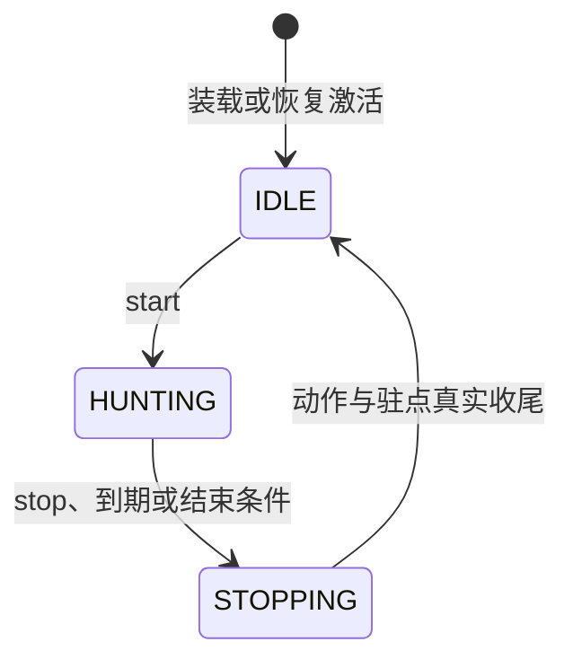

# 当前场景的连续狩猎

本文描述 #287 一期源码接口。`HuntingControlModule` 实现 `ControlModule`，类型为 `hunting-control`，负责当前实际场景内的选怪、驻点、巡找和动作调度。源码、隔离实际调用、部署及真人客户端验证分别按 Issue 留证。

狩猎控制选择目标和允许命中集合，调用 [`combat.engage`](combat.md) 完成一次交战，再根据真实结果继续选怪；驻点、巡点移动使用 [`navigation.moveTo`](navigation.md)。[恢复控制](recovery.md)独立决定用药时机。

## 待命与活动入口

模块装载及恢复激活后为 `IDLE`。通过Java强类型方法或同源脚本导出明确开始活动：

```java
HuntingStartResult start(HuntingStartOptions options);
HuntingStopResult stop();
```

```javascript
modules.call("hunting.start", {style: "AUTO", duration_ms: 30000});
```

| 参数 | 含义 |
|---|---|
| `style` | 可选，`AUTO/CAMP/PATROL/ROAM/STACK`；省略时使用模块配置的方式，仅覆盖本次活动 |
| `duration_ms` | 可选正整数毫秒；包含寻怪、等待、移动和交战，省略时持续至主动停止或其他结束条件 |

开始成功返回 `STARTED`，表示独立活动工作已经登记并完成当前场景及能力准入。已有活动或正在收尾时返回 `BUSY`，原活动条件保持；能力不可用或角色已死亡时分别返回 `UNAVAILABLE/DEAD` 并保持待命。

启动函数返回、脚本调用结束或原生脚本Context正常关闭后，活动仍由狩猎模块持续持有。后续脚本调用停止：

```javascript
modules.call("hunting.stop", {});
```

`stop()` 停止新的决策，取消本活动当前动作，并等待下游交战、导航及驻点占用真实收尾，回到 `IDLE` 后返回 `STOPPED`。待命时返回 `ALREADY_IDLE`；结束后可再次开始新的活动。



目录外壳 `SUCCEEDED` 表示本次入口方法返回。活动是否已开始、正在停止或已结束，分别读取业务结果、实际作用域及运行体事实。

## 旧规则的迁移

地图轮廓、点位、楼层和方式选择复用旧规则，原生执行接入现有动作模块：

| 方式 | 当前决策规则及来源 |
|---|---|
| `AUTO` | `GrindStylePolicy` 结合地图轮廓与 `MovementStylePolicy` 选择四种方式 |
| `CAMP` | 选择驻点并优先个人区段寻怪；已保持目标继续按驻点范围及平台判断，而非重复要求处于个人区段 |
| `PATROL` | 由可达高收益驻点组织巡点环，依既有占用顺序换点；不足两个有效巡点时采用CAMP |
| `ROAM` | 保持寻敌范围内的原目标，否则按旧评分选怪；持续无怪时等待和巡找 |
| `STACK` | 按已分配楼层优先选怪，沿旧等待规则扩大到楼层组；已保持目标按整个楼层组范围判断 |

来源为旧 [`GrindBrain`](../../src/main/java/soloMapling/ArtificialPlayer/BotGrindSystem/GrindBrain.java)、[`CampStrategy`](../../src/main/java/soloMapling/ArtificialPlayer/BotGrindSystem/CampStrategy.java)、[`PatrolStrategy`](../../src/main/java/soloMapling/ArtificialPlayer/BotGrindSystem/PatrolStrategy.java)、[`RoamStrategy`](../../src/main/java/soloMapling/ArtificialPlayer/BotGrindSystem/RoamStrategy.java) 和 [`StackStrategy`](../../src/main/java/soloMapling/ArtificialPlayer/BotGrindSystem/StackStrategy.java)。实际路径和位移继续受当前导航能力约束。

驻点占用、个人区段和楼层分配使用同一 [`BotSpotClaims`](../../src/main/java/soloMapling/ArtificialPlayer/BotSpotClaims.java) 登记来源。活动只持有本实例登记，换点、场景结束及停止时释放自己的占用。当前键为 `mapId + spotId`，首期按普通共享场景核验，跨频道和实例协调覆盖分别记录。

## 持续调度与目标保持

一次活动依次读取当前事实、选择方式与驻点、必要时导航、选择目标及允许集合、调用交战，再按结果接续下一步。同一控制实例保持一个当前移动或交战安排，允许集合包含目标且遵守交战操作的32目标边界。

交战调用使用活动中的独立受管工作。控制节拍继续观察原目标、驻点和楼层边界，目标不再符合旧保持规则时取消本次动作，等待其实际收尾后再重选。目标死亡或移除后读取当前状态继续；无怪、不可达和持续无进展沿旧规则等待、放弃目标或换点。

`duration_ms` 到期、角色死亡、实际场景变化或所需动作无法继续时结束本活动，记录原因，收尾后回待命。下一次开始重新读取当时的实际场景。模块暂停、停用、卸载和根关闭也结束活动；恢复激活保持 `IDLE`。

活动状态、当前方式、目标转换及结束原因通过业务结果和有界 `CONTROL_ACTIVITY` 事实记录。实际命中、死亡和收益继续以战斗及原生后态取证。

## 装配与工作归属

机器人类型装配 `hunting-control`、`combat` 和 `navigation`：

```yaml
modules:
  hunting:
    type: hunting-control
    config:
      style: AUTO
```

`style` 可取 `AUTO/CAMP/PATROL/ROAM/STACK`，默认 `AUTO`。活动参数可以覆盖这次方式，后续活动继续使用自己的条件。长期 `mcp_test` 装配待命的狩猎入口，见[人口参考](population.md)；临时 `hunting_probe` 等测试类型放在未提交的 `RobotPopulation.local.yaml`，按需创建。

活动与当前动作调用通过 [`ModuleTask`](../../beidou-integration/src/main/java/soloMapling/game/runtime/ModuleTask.java) 使用本模块原scope和受管carrier；原生观察沿自己的短work进入角色唯一lane。下游动作继续拥有各自scope/work，停止等待在受管载体内完成。

结束狩猎仅结束这次活动，模块、角色与MCP会话继续存在。恢复监控遵循自己的启停规则，持续狩猎与恢复可以并行。当前场景的狩猎接续到 #91 的日程组合；战斗首批真实规则和覆盖范围见[职业能力](combat-jobs.md)。

## 结果与观察

Java的 `snapshot()` 返回当前或最近活动的 `HuntingSnapshot`，其 `state()` 表达活动状态。开始、停止的JSON结果将入口结果和状态放在外层，将活动摘要放在 `activity`：

| 字段 | 含义 |
|---|---|
| `outcome`、`state`、`reason` | 本次入口结果、`IDLE/HUNTING/STOPPING` 及具体原因 |
| `activity.activity_id` | 本实例的一次活动标识 |
| `activity.requested_style`、`activity.style` | 请求方式及按当前地图解析后的实际方式 |
| `activity.duration_ms`、`activity.elapsed_ms` | 本次活动时长条件及经过时间 |
| `activity.engagements`、`activity.kills` | 调度的交战次数及从交战命中摘要确认的怪物死亡数 |
| `activity.navigation_calls` | 本活动发起的驻点或巡点导航次数 |
| `activity.end_reason`、`activity.placement` | 活动结束原因与驻点/分配摘要 |

控制调度次数、已确认死亡与最终经验/掉落分别取证。自然到期或能力、场景变化后的最近结束原因保留至下一次活动，便于后续脚本和运行体诊断核对。
