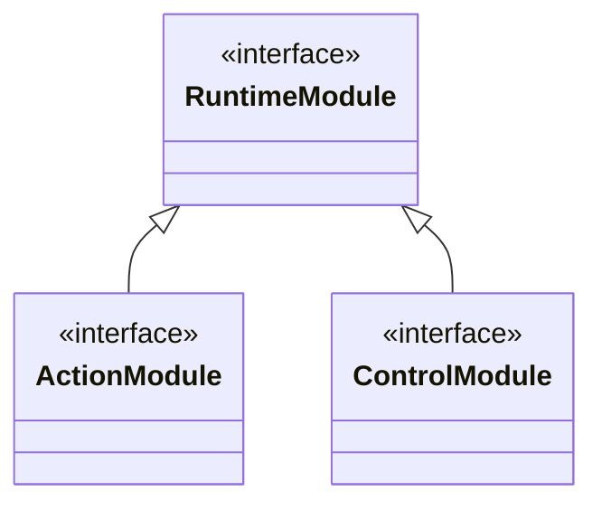

# 机器人模块定义与共享函数

本文面向接入模块的开发者，描述模块定义、类型化操作及动作/控制职责。源码测试、隔离验收和实际部署分别按 Issue 记录确认。当前类型可选择MCP控制、导航、战斗、常驻战术、原生动作、药剂、拾取控制、狩猎控制、恢复控制和世界人口能力。持续交战见[战斗参考](combat.md)，追击和避险见[战术控制](tactics.md)，单次药效见[药剂参考](potions.md)，独立拾取见[拾取控制](loot.md)，连续选怪见[狩猎控制](hunting.md)，自动用药时机见[恢复控制](recovery.md)。#322/#323 的新装配属于候选源码，实际交付按各自冻结版本与验证记录确认。

## 定义与实例配置

所有可装载模块实现 `RuntimeModule` 生命周期协议，按其对外职责分类；每项可调用操作分别声明自己的调用契约：

| 协议 | 职责 |
|---|---|
| [`RuntimeModule`](../../beidou-integration/src/main/java/soloMapling/game/runtime/RuntimeModule.java) | `onActivated/onStopping/onUnloaded` 由运行体管理装载、停止与卸载 |
| [`ActionModule`](../../beidou-integration/src/main/java/soloMapling/game/runtime/ActionModule.java) | 动作能力的装载与组合单元，在既定目标和约束内规划执行，可以提供多个不同操作 |
| [`ControlModule`](../../beidou-integration/src/main/java/soloMapling/game/runtime/ControlModule.java) | 选择或切换业务任务目标及约束，安排任务顺序和动作模块调度，决定发起、继续或中断 |
| [`ModuleFunction<M, I, R>`](../../beidou-integration/src/main/java/soloMapling/game/runtime/ModuleFunction.java) | 单项操作的输入、结果、参数与结果说明、完成条件、handler及JSON适配 |

动作与控制接口都继承 `RuntimeModule`，表达模块职责。`I`、`R` 归属于每项操作，同一模块可以提供不同输入、结果和完成条件的异构操作。通用 MCP 控制模块接受外部 Agent 或脚本的决策，世界人口模块投影世界服务入口，两者继续直接实现 `RuntimeModule`。



模块使用三个对象接入运行体：

| 对象 | 职责 |
|---|---|
| `ModuleDefinition<C, M extends RuntimeModule>` | 复用的类型标识、控制资源、scope 额度、工厂和导出声明 |
| `ModuleSelection<C>` | 本运行体内的 `instanceId`、模块自有配置 `config` 和启用标志 `enabled` |
| `CharacterRuntime.MountedModule<M>` | 挂载结果；`reference()` 是当前模块引用，`instance()` 是本次工厂创建的实际模块 |

`CharacterRuntime.mount(definition, selection)` 检查当前宿主状态并登记实例与导出名称，随后将模块自有配置交给工厂创建实例并绑定导出；启用实例随后激活。实例标识与共享函数名称在同一运行体中唯一。

工厂构造实例的私有结构与状态，角色绑定后的初始化沿生命周期 hook 进行。单项操作接受本次任务并复用这些状态，原生调用和受管资源使用提供者的 `ModuleContext`。模块只保存自己的配置及进度；角色、背包、任务等事实继续读取北斗真实来源。

## 装配方案与生命周期

机器人装配方案及配置随源码维护，通过对应测试和验收确认模块之间的组合。每个机器人按方案创建模块；正常工作周期内模块组合固定，模块的任务、状态和能力可用性随运行变化。

[`RobotPopulation.yaml`](population.md) 的 `types` 声明每个类型的模块组合及参数，加载时转换成装配计划。现有MCP普通专用角色固定使用 `mcp_test` 类型；狩猎控制与恢复控制也按各自启动约定显式装配，其他业务类型选择自己的组合。

控制模块负责选择角色活动目标、约束与任务顺序，并组织动作模块调度；动作模块完成已经确定的任务。动作可以持续执行、安排多个步骤，并为完成本次目标派生子目标、组合调用其他动作；这些选择属于执行规划。具体职责和调用关系由装配方案确定，`controls` 声明模块执行原生动作所需的控制资源。队伍人数、店铺访客数、牌桌席位及模块内部任务数量由各自业务规则管理。

- 工厂或首次激活失败时，运行体进入本实例的卸载收尾。生命周期 hook、scope 工作、资源和 Grant 真实结束后撤下导出登记。
- 暂停或停用保留实例、配置和导出声明；相关导出显示不可用。
- 恢复生成新的 `ModuleRef` 和 `ModuleContext` 代次，原引用失去调用资格。
- 卸载完成后撤下实例的导出登记。停止或卸载清理 hook 异常时保留 `FAILED`、失败原因和未完成的清理责任，根关闭继续等待真实收尾。

模块只清理自己拥有的工作与资源。角色最终退出、来源释放和唯一 lane 的关闭仍由 `CharacterRuntime` 管理。

### 持续控制工作

具体控制模块通过强类型 `start/stop` 方法及同源 `ModuleFunction` 导出管理活动。`ControlModule` 保持职责标记，活动参数、结果和自动启动策略归具体模块：狩猎装载及恢复后待命，恢复、战术和拾取控制每次激活自动开始各自监控。战术、拾取、狩猎、恢复与日程是同运行体的独立模块；调用协作不建立生命周期父子关系，结束狩猎不结束其他控制的监控。

[`ModuleTask`](../../beidou-integration/src/main/java/soloMapling/game/runtime/ModuleTask.java) 为持续活动承载模块原scope中的独立工作，并跟踪carrier真实退出。活动开始后的工作与启动函数调用分别管理，因此启动返回及脚本Context关闭后活动继续。实际观察或原生执行仍使用角色原有唯一lane中的短work；动作提供者保留自己的scope/work与取消关联。

持续活动在其scope中保留运行中的活动work，角色短命令lane可在两次执行之间为空。活动停止、本次原生命令结算和整个宿主关闭是分别核对的事实。

显式 `stop` 只结束该次活动及其下游，等待真实收尾后保留模块继续调用。模块暂停、停用、卸载和根关闭沿同一工作归属排空；`CONTROL_ACTIVITY` 在既有有界运行体事件中记录开始、转换和结束事实。

可装载的父模块可以在内部组合子模块或组件，由父模块构造、初始化和管理私有结构、启用关系、局部状态与内部调用协议，并提供统一对外契约。内部工作的资源归属及最终收尾由父模块原 scope 承担；通过共享目录调用的独立动作模块仍使用各自的 scope 与资源，取消、期限及收尾沿调用关系关联。内部查询结果由父模块解释，单项操作的业务结果由自己的 `R` 表达，整体提供者可用性由共享目录表达。

## 共享函数声明与调用

`ModuleFunction<M, I, R>` 同时保存名称、用途、参数列表、结果说明、完成条件、输入转换、强类型handler及结果投影。`describe()`、参数校验与 `bind(instance)` 使用同一声明；同一运行体中的导出名称必须唯一。`ModuleDefinition.exports` 保存 `List<ModuleFunction<M, ?, ?>>`，允许同一模块提供多个异构操作。

`Input<M, I>` 在JSON边界把已校验参数转换为具体业务输入；`Handler<M, I, R>` 接收精确提供者实例、当前提供者 `ModuleContext`、本次受管 `WorkHandle` 和 `I`，返回具体 `R`；输出适配再将 `R` 投影为该操作约定的JSON。

绑定后的 `Bound<I, R>` 为Java保留强类型调用。目录路径先调用 `Bound.prepare(arguments)`，在接受工作前完成参数校验与一次输入转换，取得捕获具体输入的 `Invocation`；原运行体在提供者受管载体上执行该调用。Java的 `Bound.invoke(input, context, work)` 与目录适配使用相同handler，消费已有的有效提供者context及本次work。跨模块调用继续经现有共享目录关联提供者工作和调用者工作。

受管调用将调用者 work 关联到提供者 work；调用取消及调用者 scope 停止持续传递，提供者工作在实际执行退出后结算。同步调用等待本次操作确认其声明的完成条件并完成收尾。导出work已在受管载体执行，handler直接消费它一次；实际原生短命令使用提供者scope的新work提交到角色唯一lane。动作组合调用同样沿现有目录传递取消、期限及收尾责任。

导航 `navigation.plan` 提供独立规划，`navigation.moveTo` 使用 `MoveToRequest → NavigationResult` 组合规划与执行。可信 Java 计划供场景执行消费，目录中的计划结果只投影值摘要，不接收任意运动帧或让脚本构造内部 Session。同一个 `RobotPopulationModule` 的 `robots.create` 与 `robots.remove` 各自保留创建、移除的输入、结果及完成条件；创建确认完整实例初始化，移除确认实际根资源和模块收尾。持续交战及原生动作也在各自操作上声明具体契约。

函数目录每次调用都解析当前登记及执行代次。暂停、停用、卸载或重新挂载后，旧的调用上下文不能借同一函数名称恢复资格。

脚本可在当前北斗引擎中使用：

```javascript
modules.help();
modules.call("example.counter.next", {label: "本次调用"});
```

| 入口 | 返回或错误 |
|---|---|
| `modules.help()` | 当前已登记导出的列表，包含名称、描述、参数、结果说明、完成条件、`module_id`、`module_generation`、`available` 及不可用时的 `reason` |
| `modules.call(name, args)` | 成功返回 `{status: "SUCCEEDED", result: ...}`；`args` 必须是 JSON 对象 |
| 函数缺失、提供者停用或未激活 | 正常返回 `{status: "UNAVAILABLE", function: name, reason: ...}` |
| 参数缺失、未知参数或类型不符 | 抛出参数异常，沿当前脚本的错误与输出契约返回 |

`UNAVAILABLE` 是该次模块函数调用的结果；脚本可以检查它并决定是否结束流程。调用者仍需具备当前有效的模块和脚本调用资格。
导出调用的 `SUCCEEDED` 表示 handler 正常返回；具体游戏结果由操作自己的结果契约表达，完成条件与结果说明在同一声明中维护。

Java 可使用 `context.call(NavigationActionModule.MOVE_TO, new MoveToRequest(x, y, remainingMs), callerWork)`，获得 `ModuleCall<NavigationResult>`；`status/reason` 表达目录可用性，`result` 保留操作的具体业务类型。该入口在当前注册的精确操作声明上调用同一handler，直接消费已构造的业务输入。JSON入口才执行schema校验与输入转换，随后共享相同的提供者工作与完成语义。

Java `ModuleContext.help()` / `call()` 与北斗引擎内的 `modules.help()` / `modules.call(name, args)` 消费同一目录。帮助可列出已挂载但暂不可用的导出，内容取决于该类型的实际装配。默认 `mcp_test` 装配导航、交战、战术、原生动作、旅行、拾取、商店、药剂、狩猎、恢复及人口能力；当前函数与参数以实际 `modules.help()` 和对应模块源码声明为准。战术导出 `combatTactics.start/stop/assessEngagement`，拾取导出 `loot.start/stop`，单次地物操作为 `native.pickup`；旧 `loot.collect` 退出目录。MCP通过 `script_run` 承接原生上下文中的脚本调用；北斗对象API的查阅沿[脚本调试技能](../../skills/solomapling-script-debug/SKILL.md)导航实际源码。

`mcp_test` 装配独立控制后仍不启动训练日程。拾取控制只选择原始 `ownerId` 等于当前 CID 的地物，这一范围包含自己通过普通 `drop` 产生的地物。一次丢弃的真实生成事实与之后被常驻控制拾回的事实分别记录，地物不承诺一直保留。需要手工核对 `drop/pickup` 时，先通过当前受管脚本调用 `modules.call("loot.stop", {})`，等待本控制真实收尾后准备材料；专项结束后正常调用 `modules.call("loot.start", {})` 恢复观察。不要为维持测试中的地物存在而增加 `player_drop` 排除规则。

持续活动的 Java 组合方可在有效上下文中用 `context.provider(operation)`，按本宿主当前目录和精确声明取得类型化提供者。它只解析协作者，正常动作仍由其具体方法或 `context.call` 执行。需要在调用方停用后收尾时，事先持有的实例配合精确活动或交互ID，只结束本次启动的工作；提供者仍使用自己的原作用域与资源清理许可。普通短步用 `context.acceptWork(parentWork)` 继承当前调用的取消，同时保留宿主结算事件；这两项接线共用既有工作账本。

## 最小协议示例

下面只演示模块私有状态、配置和导出接线，不代表已提供游戏业务能力，也不作为生产模块自动注册：

```java
record CounterConfig(int initial) { }
record CounterInput(String label) { }
record CounterResult(String label, int value) { }

final class CounterModule implements RuntimeModule {
    private final java.util.concurrent.atomic.AtomicInteger value;

    CounterModule(CounterConfig config) {
        value = new java.util.concurrent.atomic.AtomicInteger(config.initial());
    }

    int next() { return value.incrementAndGet(); }
}

ModuleFunction<CounterModule, CounterInput, CounterResult> next = new ModuleFunction<>(
        "example.counter.next", "推进本实例的私有计数",
        List.of(new ModuleFunction.Parameter(
                "label", ModuleFunction.Type.STRING, true, "本次调用的标签")),
        "返回标签和新的私有计数", "本实例计数已推进且结果已取得",
        (instance, args) -> new CounterInput((String) args.get("label")),
        (instance, context, work, input) -> new CounterResult(input.label(), instance.next()),
        result -> Map.of("label", result.label(), "value", result.value()));

ModuleDefinition<CounterConfig, CounterModule> definition = new ModuleDefinition<>(
        "counter-example", Set.of(),
        new ExecutionScope.Limits(4, 1, 4, 1),
        CounterModule::new, List.of(next));

CharacterRuntime.MountedModule<CounterModule> mounted = runtime.mount(
        definition, new ModuleSelection<>("counter-one", new CounterConfig(0), true));
```

这里的 `runtime` 已经绑定真实角色来源。运行体中其他有效模块可以通过自己的 `ModuleContext.call` 调用导出；当前受管北斗脚本中使用相同名称调用。

## 与北斗脚本环境的关系

脚本继续通过原 `kind/operation` 选择 `npc/quest/portal/reactor/event` 上下文。`modules` 在该原生引擎中绑定，参数和结果通过 JSON 传递；它不替代原脚本文件及原生入口。

`cm/qm/pi/rm/em` 仍按各自真实对象来源和作用范围提供，`executeCommand(text)` 保留已有命令桥行为。已有北斗 Java API 直接复用；模块只显式导出自身提供的共享能力。对象来源见[北斗脚本上下文](beidou-script-environment.md)，执行、错误和取消语义见[脚本执行](script-execution.md)。
